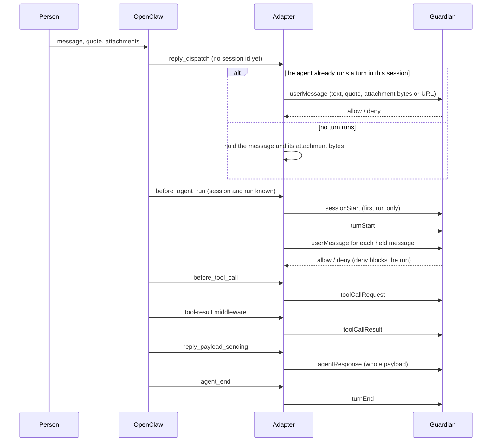

# OpenClaw hooks and ACS steps

This page maps each OpenClaw hook to ACS steps. It states when the adapter sends each step, how the adapter enforces each decision, and what the adapter cannot govern on stock OpenClaw. Hook names come from OpenClaw's `PLUGIN_HOOK_NAMES`. `tests/mapping.test.ts` fails if either table omits a hook or ACS step.

Three rules hold everywhere:

- The adapter forwards the data each hook provides. It does not rebuild data that OpenClaw composes, and it does not know tools or channels by name. [Gaps](#gaps) lists data that no hook provides.
- The adapter does not check OpenClaw settings. The Guardian decides, and the adapter enforces the decision (§6.4). The adapter blocks a decision it cannot apply as sent (§6.5). A tool call, user message or reply the adapter cannot send, because OpenClaw does not provide a required fact, is blocked; a tool result it cannot send follows the failure posture (§6.4).
- The adapter does not send a step that the Guardian's ServerHello omits from `methods_evaluated`; the step is allowed (`handshake.json`). The adapter sends a decision-eligible step only from a hook that can enforce the answer.

## The path of one message

`reply_dispatch` is the only hook that carries a message and its attachments as the person sent them. OpenClaw loads attachments into the model after all hooks have run. The adapter reads attachment bytes from the paths OpenClaw provides because a Guardian on another host cannot open those paths. OpenClaw selects the session after this hook. A message that starts a run therefore waits for `before_agent_run`, where ACS can open the session and turn before the message (`session-lifecycle.md`).

## Every OpenClaw hook

| OpenClaw hook | What it is in OpenClaw | ACS steps, and when | Can enforce |
|---|---|---|---|
| `reply_dispatch` | A message arrived | **The agent already runs a turn in the session:** The adapter sends `userMessage` in that turn. It sends no turn id if two runs in the session are live. **Otherwise:** The adapter holds the message and attachments for `before_agent_run`. | Yes. A refusal claims the dispatch. OpenClaw then starts no run and steers nothing. |
| `before_agent_run` | The agent is about to run, one turn. | The adapter waits until any earlier run in the same session finishes admission. **First run in the session:** The adapter sends `sessionStart`. **Run started without a person's message:** The adapter sends `agentTrigger` with the run's text as `trigger_source.prompt`. Examples include schedules, heartbeats, system events, hooks, relays, and sub-agent tasks. **Every run:** The adapter sends `turnStart`. **Held messages:** The adapter sends one `userMessage` per message, with the original text and attachments. **Person started the run, with no held messages** (input through `chat.send`): The adapter sends `userMessage` with the run's text. | Yes. OpenClaw blocks the run, including when the hook fails. |
| `before_tool_call` | The agent calls a tool | The adapter sends `toolCallRequest` with the tool name and arguments for every tool. **`ask`:** The adapter requests an OpenClaw approval. The tool name becomes the title. The Guardian's question and context describe the request. | Yes. The adapter can block the call or run it with the Guardian's parameters. |
| `registerAgentToolResultMiddleware` | A tool's result, before the model reads it. OpenClaw registers this middleware outside `api.on`. | The adapter sends `toolCallResult` with `request_id_ref` naming the request whose decision it applied. | Yes. The model reads the Guardian's rewrite or `[OUTPUT WITHHELD BY POLICY]`. |
| `reply_payload_sending` | The agent sends a complete reply. | The adapter sends `agentResponse` with the text, fallback and spoken text, each structured part as JSON text, and each media URL as a `file` item. | Yes. The adapter can send the reply, replace its text and media, or cancel it. |
| `message_sending` | A delivery leaves OpenClaw. | **Every delivery:** The adapter sends a tool delivery or a part of a reply already decided by `reply_payload_sending` as `agentResponse`. It uses the session OpenClaw names for the run that wrote the delivery. **No session named or admitted:** The adapter sends no step and blocks the delivery. | Yes. The adapter can send, replace the text, or cancel. |
| `after_tool_call` | A tool call returned. | The adapter sends no step. It records that the call ran for its result in any registration. | No. The hook is for audit only. |
| `agent_end` | The agent finished its turn. | The adapter sends `turnEnd`. | No. The hook is for audit only. |
| `subagent_spawned` | OpenClaw launched a sub-agent | The adapter sends no step. The hook names the parent's session, not the parent's step required by `subagentStart` ([Sub-agents](#sub-agents)). | No. The hook only notifies the adapter after launch. |
| `subagent_ended` | A sub-agent finished. | The adapter sends no step because it sent no `subagentStart` ([Sub-agents](#sub-agents)). | No. The hook is for audit only. |
| `session_end` | A session ended. | **OpenClaw continues with the same session id (`nextSessionId`), as on an ordinary reset:** The ACS session continues, so the adapter sends no step. **Otherwise:** The adapter sends `sessionEnd`. | No. The hook is for audit only. |
| `gateway_start` | The gateway started | The adapter sends `system/ping`, then sends one every `pingIntervalMs`. It restores admitted sessions from OpenClaw's plugin state. | No. |
| `before_dispatch` | A message arrived, before `reply_dispatch` | The adapter sends no step. `reply_dispatch` sees the same message and its attachments. | No. The hook could enforce a decision, but the adapter does not use it. |
| `message_received`, `message_sent` | These hooks report a message. | They only observe the message after dispatch or delivery. The adapter sends no step. | No. They cannot enforce a decision. |
| `before_model_resolve`, `agent_turn_prepare`, `before_prompt_build`, `before_agent_reply`, `model_call_started`, `model_call_ended`, `llm_input`, `llm_output`, `before_agent_finalize` | OpenClaw prepares and calls the model. | ACS v0.1 has no step for a model call ([Discussion #321](https://github.com/GenAI-Security-Project/agent-control-standard/discussions/321)). The adapter sends no step. | These hooks cannot enforce a decision. |
| `before_compaction` | History is about to be compacted | The adapter sends no step. `preCompact` is decision-eligible, but the hook cannot stop compaction and provides no ACS step ids for `entries_to_compact`. | No. |
| `after_compaction` | History was compacted | The adapter sends no step. `postCompact` requires the summary text and chain hashes, which the event does not carry. | No. |
| `before_install`, `skill_changed` | A skill or plugin is installed or changed. | The adapter sends no step. Installation happens outside a conversation, with no session or person for `skillRegister`. | These hooks cannot enforce a decision. |
| `session_start` | A session started | The adapter sends no step. It sends `sessionStart` on the session's first run, where the person is known. | No. |
| `before_reset` | A session is about to be reset. | The adapter sends no step. `session_end` reports the reset. | This hook cannot enforce a decision. |
| `inbound_claim` | A plugin takes a conversation bound to it. | The adapter sends no step. OpenClaw calls only the bound plugin ([Gaps](#gaps)). | This hook cannot enforce a decision. |
| `subagent_progress`, `subagent_delivery_target` | These hooks report sub-agent progress and the reply destination. | They only observe. The adapter sends no step. | No. They cannot enforce a decision. |
| `tool_result_persist`, `before_message_write` | These hooks write to the transcript. | The adapter sends no step. The model reads a result through the middleware first. | These hooks cannot enforce a decision. |
| `channel_pairing_requested` | A person asks to pair with a channel. | The adapter sends no step because no conversation or session exists yet. | This hook cannot enforce a decision. |
| `cron_changed`, `cron_reconciled` | The schedule changed. | The adapter sends no step. A scheduled run is decided when it runs, at `before_agent_run`. | These hooks cannot enforce a decision. |
| `heartbeat_prompt_contribution` | OpenClaw creates text for a heartbeat run. | The adapter sends no step here. The heartbeat run itself passes through `before_agent_run`. | This hook cannot enforce a decision. |
| `resolve_exec_env` | OpenClaw resolves the environment for an `exec` call. | The adapter sends no step. It decided the call at `before_tool_call`. | This hook cannot enforce a decision. |
| `gateway_stop` | The gateway stops. | The adapter sends no step. It stops `system/ping`. `session_end` reports the sessions. | No. The hook cannot enforce a decision. |

The adapter waits for the Guardian in these hooks: `reply_dispatch`, `before_agent_run`, `before_tool_call`, `reply_payload_sending`, and `message_sending`. Each hook answers within `deadlineMs`. OpenClaw lets the original message or reply through if `reply_dispatch`, `reply_payload_sending`, or `message_sending` throws or times out. Each of those hooks catches every failure and refuses the operation.

### Why one OpenClaw hook gives several ACS steps

OpenClaw and ACS divide one event differently. OpenClaw treats "the agent is about to run" as one event: `before_agent_run`. ACS describes that moment with several ordered steps. The session starts on its first run. The agent is activated. A turn starts. The person's message arrives. The adapter sends those steps from that hook, in order, only when the Guardian asks for them.

For example, a person writes "hello" for the first time. OpenClaw calls `before_agent_run` once. The adapter sends `sessionStart`, `turnStart`, then `userMessage "hello"`. The person's next message in the same session sends `turnStart` and `userMessage`. The adapter admits two simultaneous runs in sequence, so it sends `sessionStart` once.

### Why `userMessage` or `agentTrigger`, not both

ACS-Core requires "`userMessage` or `agentTrigger`" (`conformance.md`, the minimum hook set). These steps describe what activated the agent. A person's message is an activation, so a run started by a person sends `userMessage` and no `agentTrigger`. Other runs send `agentTrigger`. Examples include scheduled runs, heartbeats, system events, hooks, relays from another session, and sub-agent tasks. The adapter sends the run's `trigger_type` and text in `trigger_source.prompt`. The Guardian can then see what the agent was asked to do. A peer agent's message arrives on its channel as `userMessage`, like any other message. OpenClaw's hook does not identify the sender as an agent.

### Why `userMessage` comes from two hooks

A message goes to the Guardian once, from the first hook where its session is known. When the agent already runs a turn, OpenClaw adds the message to that turn and does not call `before_agent_run`. The adapter sends the message at `reply_dispatch`. Otherwise, OpenClaw has not selected the session. The message waits for `before_agent_run`, where ACS opens the session and turn before the message.

### Why `agentResponse` comes from two hooks

`reply_payload_sending` sees the whole reply and can replace its text and media. The Guardian decides the reply there. `message_sending` sees every delivery, including a tool send. OpenClaw gives this hook no link to an earlier step for that delivery. The adapter therefore sends a new `agentResponse` step for each delivery. The Guardian decides each delivery again. A delivery never passes because its text matches a reply decided earlier.

### Who a step acts for

`user_context` contains the channel's id for the person who wrote the message and the channel's name (`signal`, `whatsapp`). A scheduled run in an admitted session acts for the person admitted to that session. In a group, this is the first person whose run was admitted because OpenClaw names no person for a scheduled run. In a group, each run acts for the person whose message started it. A message that joins a running turn acts for its own sender. A reply acts for the person of the run that wrote it. The adapter uses the run named by OpenClaw, or the session's one live run, or its last ended run, in that order. If OpenClaw names a run that the adapter no longer holds, the step names no person. The ClientHello offers only the steps the adapter sends. It does not offer `subagentStart` or `subagentStop`. A person does not start scheduled runs, relays from another session, or sub-agent runs. ACS makes `user_context` optional for these runs, and the Guardian decides what to do.

OpenClaw names the delivery's session to `message_sending`. OpenClaw's contract says this is the session of the run that produced the delivery (`OutboundSessionContext.key`, `src/infra/outbound/session-context.ts`). In OpenClaw 2026.10.9, a tool send to another conversation names the destination's session instead (`deliver-prepare.ts`, `params.mirror?.sessionKey`). If a run was admitted in that destination session, the adapter sends the delivery to the Guardian as `agentResponse` for that session. The Guardian decides the delivery, and the adapter enforces the answer. Otherwise, the adapter blocks it. The Telegram channel calls `message_sending` without a session for fallback, structured, and command replies (`extensions/telegram/src/bot/delivery.replies.ts`). The adapter blocks those deliveries too. Fixing both cases requires OpenClaw to pass the sending run's session to the hook.

### Sub-agents

ACS-Core requires `subagentStart` for a sub-agent spawned by the framework. The step must name the parent's spawning step in `parent_step_id`. It must also say how the sub-agent's rights relate to the parent's in `intent_derivation`. OpenClaw names a sub-agent's parent only in `subagent_spawned`, after launch. That hook names only the parent's session. No hook names the parent's step or the rights relation. The adapter therefore sends no `subagentStart` or `subagentStop`. The sub-agent still runs under governance. The adapter sends the spawning call as `toolCallRequest` in the parent's session. The Guardian decides that call. The adapter sends each sub-agent run as a run that no person started, in the sub-agent's own session.

## Every ACS step

| ACS step | OpenClaw hook | What is sent | Gap |
|---|---|---|---|
| `steps/sessionStart` | `before_agent_run`, the session's first run | The adapter sends the person as `user_identity`, when there is one, and sends the channel. | No gap. |
| `steps/agentTrigger` | `before_agent_run`, for a run no person's message started | The adapter sends `trigger_type` (`scheduled`, `system`) and `trigger_source` with the channel and run text. | No gap. |
| `steps/turnStart` | `before_agent_run` | The adapter sends `turn_id` (the run id) and `triggered_by`. | No gap. |
| `steps/userMessage` | The adapter uses `reply_dispatch` for a message that joins a running turn. It uses `before_agent_run` for each held message. It also uses that hook for the run's text when a person started the run and no message is held. | The adapter sends the quoted message, text, and each attachment as bytes. If OpenClaw holds only a URL, the adapter sends the URL. | OpenClaw may add data to the model request. Other gaps include `chat.send`, voice, media and link understanding, and images named by path ([Gaps](#gaps)). |
| `steps/toolCallRequest` | `before_tool_call` | The adapter sends the tool name and arguments. | No gap. |
| `steps/toolCallResult` | Tool-result middleware | The adapter sends the result. | Tool Search, Code Mode, and a result-rewriting plugin can bypass the middleware ([Gaps](#gaps)). |
| `steps/agentResponse` | `reply_payload_sending`; `message_sending` for every delivery | The adapter sends the whole reply payload, including the text and media URLs. | Cron completion webhooks bypass delivery hooks ([Gaps](#gaps)). |
| `steps/turnEnd` | `agent_end` | The adapter sends the outcome and tool-call count. | OpenClaw delivers the final reply after `agent_end`. That reply's `agentResponse` has no `turn_id` because it falls outside the closed turn. |
| `steps/sessionEnd` | `session_end`, unless OpenClaw goes on with the same session id | The adapter sends the reason. | No gap. |
| `steps/subagentStart` | None | The adapter sends no step because no hook names `parent_step_id` or `intent_derivation` ([Sub-agents](#sub-agents)). | The Guardian cannot see the link between a sub-agent and its parent. |
| `steps/subagentStop` | None | The adapter sends no step because it sent no `subagentStart`. | No gap. |
| `steps/preCompact` | None | The adapter sends no step because `before_compaction` cannot stop compaction. | Compaction is not governed. |
| `steps/postCompact` | None | The adapter sends no step because `after_compaction` carries no summary text. | Compaction is not governed. |
| `steps/memoryStore` | `before_tool_call` for a memory tool | The adapter sends the request as `toolCallRequest`. | A memory plugin can capture data automatically ([Gaps](#gaps)). |
| `steps/memoryContextRetrieval` | Tool-result middleware for a memory tool | The adapter sends the result as `toolCallResult`. | A memory plugin can recall data automatically ([Gaps](#gaps)). |
| `steps/knowledgeRetrieval` | Tool-result middleware for a retrieval tool | The adapter sends the result as `toolCallResult`. | No gap. |
| `steps/skillRegister` | None | The adapter sends no step because installs happen outside conversations. | Skill installs are not governed. |
| `steps/skillLoad` | None | The adapter sends no step because OpenClaw has no hook for loading a skill. | Skill loads are not governed. |
| `steps/skillUnload` | None | The adapter sends no step because OpenClaw has no hook for unloading a skill. | No gap. The step is audit only. |

OpenClaw has no hook for memory itself. An agent reads and writes memory through tools such as `memory_search` and `memory_get`, so the Guardian decides those tool calls. The adapter does not send `agbom/*` because ACS-Core does not require it. The adapter does not send `protocols/MCP/*` ([Gaps](#gaps)). The gateway sends `system/ping` every `pingIntervalMs`, outside any session. A failed probe produces a warning in OpenClaw's log and decides no step (§13). `sessionEnd` carries `summary.decision_failures`, which counts the session's failures by class if this registration saw the session start.

## OpenClaw's internal hook events

OpenClaw also calls handlers registered with `registerHook` for eight internal events. These handlers only notify. OpenClaw catches a handler's error and continues (`src/hooks/internal-hooks.ts`). None of these handlers can enforce a decision.

| Event | Why it is not used |
|---|---|
| `command:new`, `command:reset`, `session:auto-reset` | A reset ends or keeps the session. `session_end` reports the result with `nextSessionId`. |
| `message:received`, `message:sent` | The same messages pass through `reply_dispatch` and the reply hooks. Those hooks can block them. |
| `agent:bootstrap` | These handlers may change workspace files that OpenClaw adds to the agent's context ([Gaps](#gaps)). |
| `gateway:startup`, `gateway:shutdown` | The gateway decides no step when it starts or stops. |

## Gaps

This section lists what reaches the model, a person, or another party on stock OpenClaw without a Guardian decision. It also lists what a deployment can do about each path. The adapter does not turn off these features. A deployment that uses ACP, Tool Search, Code Mode, or a plugin that changes a call or result after the decision does not meet ACS-Core. Those paths lose `toolCallResult` or decision honoring (`conformance.md`).

| Path | What passes undecided | What a deployment can do |
|---|---|---|
| What OpenClaw adds to the model request | OpenClaw adds context beside the person's message. This context includes the sender's name, chat history, forwarded and thread content, and recent history images. `before_agent_run` receives some of this data (`prompt`, `systemPrompt`, `messages`). No hook receives the final model request. The adapter forwards the person's message, not OpenClaw's composed request. ACS v0.1 has no step for a model call ([Discussion #321](https://github.com/GenAI-Security-Project/agent-control-standard/discussions/321)). Each history message was decided when it arrived, except a message the Guardian refused. A channel such as Telegram caches a refused message before every hook. The message can then return in a later reply's history. | The Guardian's policy can treat the person's message as the input it decided. The model may still read more. |
| Spoken replies (text to speech) | OpenClaw sends reply text to the speech provider before delivery (`tts-payload.ts`). A refusal at `agentResponse` stops the delivery, but not the synthesis. | Turn off text to speech if reply text must not leave first. |
| Workspace files in the agent's context (`AGENTS.md`, `USER.md`, `agent:bootstrap`) | OpenClaw adds these files to every run's context, beyond the reach of every hook. | Keep only files in the workspace that the Guardian's policy allows the model to read. |
| Gateway `chat.send` and voice controls | These controls put text and attachments into a running turn. No dispatch hook sees this input. | Give the gateway's `operator.write` scope only to people trusted by the Guardian's policy. |
| Media and link understanding | Between `reply_dispatch` and `before_agent_run`, OpenClaw sends audio to a speech-to-text provider. It extracts text from files and fetches links. The adapter sends a message that joins a running turn at `reply_dispatch`. The Guardian decides that message there. The adapter sends a message held for the next run at `before_agent_run`, after media and link processing. The Guardian decides that message there. The provider and link therefore receive the message before a decision. | Set each option below to `false` if the data must not leave first. The options are `tools.media.audio.enabled`, `tools.media.image.enabled`, `tools.media.video.enabled`, and `tools.links.enabled`. |
| WhatsApp audio transcription | The channel transcribes voice notes before dispatch. | No adapter hook runs before the channel transcribes voice notes. |
| An image named by its path in the message text | For a model that reads images, OpenClaw loads a workspace image named by the message after `before_agent_run` (`detectImageReferences`). The Guardian sees the path, not the image. | Keep files the model must not see out of the workspace, or refuse those paths in the Guardian's policy. |
| A conversation bound to a plugin | OpenClaw hands the conversation to that plugin's `inbound_claim` before any dispatch hook. | Do not bind a conversation to another plugin. |
| Cron completion webhooks | OpenClaw posts a cron run's outcome to a webhook outside every delivery hook. This happens for `delivery.mode: "webhook"`, a `delivery.completionDestination` webhook under any mode, and a failure webhook (`server-cron-notifications.ts`). | Do not configure a cron job with a webhook in `delivery.mode`, `delivery.completionDestination`, or its failure notification. |
| Compaction | OpenClaw replaces history with a summary. No hook can stop compaction or provide the summary. | Stock OpenClaw provides no control for this path. |
| A pending tool approval | A session refusal cannot revoke an approval already returned to OpenClaw ([Approvals](README.md#approvals)). | The reviewer can deny the pending approval. The adapter has no cancellation API. |
| MCP servers | ACS-Core requires `protocols/MCP/*` wrapping when sessions use MCP. OpenClaw gives the model MCP tool calls, resource reads (`resources_read`), and prompt fetches (`prompts_get`) as tools. The adapter sends those calls as `toolCallRequest` steps and results as `toolCallResult` steps. The Guardian decides each step. The MCP handshake and notifications reach no step. | Configure no MCP server where ACS-Core is required. |
| A message OpenClaw queues for a run of its own | The Guardian decides a message that arrives during a run at `reply_dispatch` as that run's message. OpenClaw may instead hold it for a later run (queue mode `followup` or `collect`). The Guardian decides the message text again for that run. The hook does not say which path OpenClaw will use. | The Guardian may decide the message twice, but the message is never undecided. |
| A sub-agent's link to its parent | The adapter does not send `subagentStart`, so the Guardian cannot see which run spawned the sub-agent or what rights it inherits. The adapter sends the spawning call as `toolCallRequest`. The Guardian decides the call. The adapter sends the sub-agent's steps for no person in its own session. | The Guardian's policy decides `sessions_spawn` at the call. |
| `sessions_send` into another session | The message enters the target session's running turn without passing its dispatch hooks. The adapter sends the `sessions_send` call as `toolCallRequest`. The Guardian decides the call. | No control is available. |
| ACP sessions | ACP runs do not call `before_agent_run`. The adapter therefore sends none of their steps. | No control is available. |
| Tool Search and Code Mode | The adapter sends a tool call from either feature as `toolCallRequest`. The Guardian decides the call. The result reaches the model without passing through tool-result middleware, so the adapter sends no `toolCallResult`. | No control is available. |
| Another plugin that changes a call or a result (`onepassword`, `tokenjuice`) | OpenClaw keeps the other plugin's parameters or approval. It can also rewrite a result after the decision. | No control is available. |
| Memory plugins (`memory-core`, `active-memory`, `memory-lancedb`, `diffs`) | Text added to the prompt passes without a step. `memory-lancedb`'s automatic capture also passes without a step. | No control is available. |
