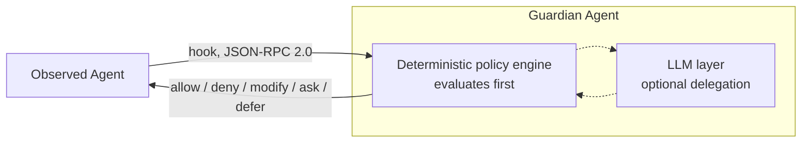

# OWASP GenAI Security Project Agent Control Standard

The OWASP GenAI Security Project Agent Control Standard (ACS) is a wire-format specification that lets a separate **Guardian Agent** permit, deny, or modify what an AI agent does in real time, over an authenticated channel and with an observable, reconstructable audit trail.

Agents that implement ACS-Core run every step through a Guardian over an authenticated channel and honor its decisions in real time. With the Trace, Inspect, and Crypto profiles they also emit OpenTelemetry spans and OCSF events, expose a dynamic Agent Bill of Materials (models, MCP servers, A2A peers, tools, knowledge sources, memory stores), and gain cryptographic non-repudiation of the audit chain. ACS-Core authenticates the channel and binds the agent to the Guardian's decisions; it does not by itself make a deployment secure or its policies strict, and tamper-evidence against a compromised Guardian is the Crypto and Audit profiles, not Core.

ACS extends existing standards rather than reinventing them: JSON-RPC 2.0 for the wire format, OpenTelemetry and OCSF for observability, CycloneDX / SPDX / SWID for the AgBOM, MCP and A2A intact for tool and peer communication.

The diagram below shows a hook's round trip: the Observed Agent sends it to the Guardian, the deterministic layer evaluates first, and one of five dispositions returns.



The Guardians in release 0.1.5 run the deterministic layer only. None of them ships an LLM layer.

## What specification v0.1.0 defines

`v0.1.0` is the specification version, which names the schema namespace, and a release can update the schemas inside it. The release number changes with each release, as the [releases page](https://github.com/GenAI-Security-Project/agent-control-standard/releases) and the [CHANGELOG](https://github.com/GenAI-Security-Project/agent-control-standard/blob/main/CHANGELOG.md) record.

- **ACS-Core** (mandatory baseline) — capability-negotiation handshake, JSON-RPC envelope, minimum hook set (`sessionStart`, `userMessage` or `agentTrigger`, `toolCallRequest`/`Result`, `agentResponse`, `sessionEnd`, `subagentStart` for subagent-capable frameworks), four MUST-support dispositions (`allow`, `deny`, `ask`, `defer`) with `modify` SHOULD-support, `defer/subscribe` for Guardians that return DEFER, SessionContext with rolling SHA-256 chain hash, optional Intent with immutability rule, replay protection, baseline HMAC-SHA256 signature, decision honoring, declared liveness mechanism (`system/ping` or a transport-level alternative), and Wrapped MCP when sessions involve MCP. Additional hooks (`turnStart`/`End`, `preCompact`/`postCompact`, `subagentStop`, `knowledgeRetrieval`, `memoryContextRetrieval`, `memoryStore`, `skillRegister`/`Load`/`Unload`) are normatively defined and SHOULD be implemented when the harness can observe the corresponding event.
- **ACS-Trace** profile — OpenTelemetry semconv mapping + OCSF event-class mapping, with decisions emitted as span events on the parent step span.
- **ACS-Inspect** / **ACS-Inspect-Dynamic** profiles — canonical AgBOM with `agbom/snapshot` and `agbom/changed`, deterministic CycloneDX / SPDX / SWID derivations.
- **ACS-Provenance** profile — field-level `Provenance` objects with `origin`, `source_id`, `derived_from`, and an OPTIONAL wire-format `trust` enum that obeys the monotonicity rule.
- **ACS-Crypto** profile — crypto-agile signature registry: HMAC-SHA256 baseline, ML-DSA-65 / SLH-DSA-128s for PQC, hybrid composites for transitional deployments.
- **ACS-Audit** profile — `request_hash` on every ContextEntry so the chain commits to request content, not just step metadata.

See [Conformance Profiles](./spec/conformance.md) for what each profile requires.

## Trustworthy agents are

ACS publishes no SDK, so this page shows the wire messages themselves rather than library calls ([D-033](./decisions/index.md#d-033-remove-sdk-examples-from-the-documentation)). Every example below follows the v0.1.0 schemas and mapping files.

To watch an agent governed today, run one of the reference implementations that release 0.1.5 ships. Adapters govern Claude Code, Cursor and NVIDIA NAT through each host's own hook or middleware configuration, with no agent code changes. In its enforce mode, a gateway governs any OpenAI Responses API client. [What runs in release 0.1.5](./spec/instrument/README.md#what-runs-in-release-015) lists each one, the hooks it covers and how it fails.

### Instrumentable

???+ example "Runtime Hooks"

    **Value**: Hooks to agent runtime and lifecycle events.

    **Description**: Specifies hooks that allow intervention at agent's lifecycle and run-time execution.

    **Standards**: [ACS Instrument](./spec/instrument/README.md).

    === "ACS wire (JSON-RPC)"

        Before a tool runs, the agent sends the call to the Guardian as [`steps/toolCallRequest`](./spec/instrument/hooks.md#toolcallrequest) and waits for the decision. Here the agent wants to run `SELECT * FROM customers`:

        ```json
        {
          "jsonrpc": "2.0",
          "method": "steps/toolCallRequest",
          "id": "rpc-42",
          "params": {
            "acs_version": "0.1.0",
            "request_id": "c329d5a4-97ae-44c8-986d-77d1da194ab7",
            "timestamp": "2026-10-13T09:15:00Z",
            "metadata": {
              "agent_id": "research-assistant",
              "session_id": "17a301f1-6d17-4941-8bea-92320f0773aa"
            },
            "payload": {
              "tool": { "name": "database_query" },
              "capability": "datastore.read",
              "arguments": {
                "query": { "value": "SELECT * FROM customers" }
              }
            },
            "signature": {
              "algorithm": "HMAC-SHA256",
              "value": "<base64 HMAC-SHA256 over UTF-8 JCS(envelope without params.signature)>",
              "key_id": "acs-hmac-key-1"
            }
          }
        }
        ```

        The Guardian answers `modify`. Its `parameter_overrides` replaces the `query` argument, so the agent runs the narrowed query instead of the original:

        ```json
        {
          "jsonrpc": "2.0",
          "id": "rpc-42",
          "result": {
            "type": "final",
            "acs_version": "0.1.0",
            "request_id": "c329d5a4-97ae-44c8-986d-77d1da194ab7",
            "decision": "modify",
            "reasoning": "Narrowed the query to two columns and 100 rows. A full customer export violates the data-protection policy.",
            "reason_codes": ["pii_detected"],
            "policy_references": [
              { "policy_id": "data-protection", "rule_id": "limit-customer-export" }
            ],
            "modifications": {
              "parameter_overrides": {
                "query": "SELECT id, name FROM customers LIMIT 100"
              }
            },
            "chain_hash": "25d878e6726ecf3bd9ee823d7642bdd78f148c0db5c06a585d16bc23494e2175",
            "metadata": { "evaluator": "deterministic" },
            "signature": {
              "algorithm": "HMAC-SHA256",
              "value": "<base64 HMAC-SHA256 over UTF-8 JCS(envelope without result.signature)>",
              "key_id": "acs-hmac-key-1"
            }
          }
        }
        ```

        The exchange follows four rules:

        - **Signatures.** ACS-Core requires signatures on this request and response. Remove `params.signature` from the request or `result.signature` from the response, canonicalize the remaining envelope with JCS, and encode it as UTF-8 before signing ([§10](./spec/instrument/specification.md#10-cryptographic-signatures)). The `value` fields above are placeholders. The identifiers and `chain_hash` are sample values.
        - **Chain head.** The Guardian publishes `chain_hash` on every content-bearing step, so an observer can detect a rewritten audit chain ([§8.6](./spec/instrument/specification.md#86-chain-head-publication-normative)).
        - **MODIFY support.** `modify` is SHOULD-support. A client that doesn't implement it receives `deny` with `reason_codes: ["modify_unsupported"]` instead ([§6.5](./spec/instrument/specification.md#65-modify-incapable-clients-normative)).
        - **Protocols.** An MCP `tools/call` can travel through this same hook ([Instrument MCP](./spec/instrument/extend_mcp.md)). A2A wrapping is planned for specification v0.2.0.

### Traceable

???+ example "Comprehensive Audit Logs"

    **Value**: Comprehensive audit logs.

    **Description**: Specifies events that capture AI agent lifecycle and runtime execution. Extends OpenTelemetry and OCSF specs with these properties.

    **Standards**: [ACS Trace](./spec/trace/README.md). Extends [OpenTelemetry](./spec/trace/extend_opentelemetry.md), [OCSF](./spec/trace/extend_ocsf.md).

    === "OpenTelemetry"

        This is the span a Guardian exports for the `steps/toolCallRequest` exchange in [Instrumentable](#instrumentable), in the OTLP/JSON shape that [Trace with OpenTelemetry](./spec/trace/extend_opentelemetry.md) describes. The span name and attributes come from [`trace/otel-mapping.json`](https://genai-security-project.github.io/agent-control-standard/schema/v0.1.0/trace/otel-mapping.json). The trace and span identifiers are sample values.

        ```json
        {
          "traceId": "4bf92f3577b34da6a3ce929d0e0e4736",
          "spanId": "00f067aa0ba902b7",
          "name": "gen_ai.tool.call",
          "kind": 1,
          "startTimeUnixNano": "1791882900000000000",
          "endTimeUnixNano": "1791882900042000000",
          "attributes": [
            { "key": "acs.session.id", "value": { "stringValue": "17a301f1-6d17-4941-8bea-92320f0773aa" } },
            { "key": "acs.request_id", "value": { "stringValue": "c329d5a4-97ae-44c8-986d-77d1da194ab7" } },
            { "key": "gen_ai.tool.name", "value": { "stringValue": "database_query" } },
            { "key": "acs.capability", "value": { "stringValue": "datastore.read" } }
          ],
          "events": [
            {
              "name": "acs.decision",
              "timeUnixNano": "1791882900042000000",
              "attributes": [
                { "key": "acs.decision", "value": { "stringValue": "modify" } },
                { "key": "acs.evaluator", "value": { "stringValue": "deterministic" } },
                { "key": "acs.reasoning", "value": { "stringValue": "Narrowed the query to two columns and 100 rows. A full customer export violates the data-protection policy." } },
                { "key": "acs.reason_codes", "value": { "arrayValue": { "values": [{ "stringValue": "pii_detected" }] } } },
                { "key": "acs.policy.ids", "value": { "arrayValue": { "values": [{ "stringValue": "data-protection" }] } } },
                { "key": "acs.policy.versions", "value": { "arrayValue": { "values": [{ "stringValue": "" }] } } },
                { "key": "acs.policy.rule_ids", "value": { "arrayValue": { "values": [{ "stringValue": "limit-customer-export" }] } } },
                { "key": "acs.chain_hash", "value": { "stringValue": "25d878e6726ecf3bd9ee823d7642bdd78f148c0db5c06a585d16bc23494e2175" } }
              ]
            }
          ]
        }
        ```

        The step is a span and the decision is an `acs.decision` event on it, so the verdict and the action it gates share a parent. A reader joins this span to the Observed Agent's own record on `acs.session.id` plus `acs.request_id`. `acs.policy.versions` holds `""` because the response's policy reference carries no version, which keeps the three policy arrays aligned by position. The event records what the Guardian decided. Only the Observed Agent knows what it applied, and [Trace Events](./spec/trace/events.md) gives the rule for counting a decision as enforced.

    === "OCSF"

        This OCSF 1.9.0 example follows the [Trace class mapping](./spec/trace/events.md#ocsf-event-classes). A `run_command` tool launches `/usr/bin/printf hello`, and the host runtime observes its subprocess exit with code `0` at `2026-10-09T12:00:00Z`.

        The `steps/toolCallResult` trace uses Process Activity (`1007`). This is a reflexive [Terminate activity](https://schema.ocsf.io/classes/process_activity): `printf` exits on its own, so both `actor.process` and `process` identify `printf`. Each records the Python runtime as `parent_process`. The identifiers below are sample values for this scenario.

        ```json
        {
          "activity_id": 2,
          "activity_name": "Terminate",
          "category_uid": 1,
          "category_name": "System Activity",
          "class_uid": 1007,
          "class_name": "Process Activity",
          "type_uid": 100702,
          "severity_id": 1,
          "time": 1791547200000,
          "status_id": 1,
          "status": "Success",
          "metadata": {
            "version": "1.9.0",
            "product": {
              "name": "ACS trace example",
              "vendor_name": "Example Corp"
            },
            "correlation_uid": "7673ad6b-b5b3-4eec-8f46-66c83eef0b52:1287ce09-fcda-4588-a5e9-3fa83bfe5291"
          },
          "actor": {
            "process": {
              "pid": 4243,
              "name": "printf",
              "cmd_line": "/usr/bin/printf hello",
              "terminated_time": 1791547200000,
              "parent_process": {
                "pid": 4242,
                "name": "python",
                "cmd_line": "python agent.py"
              }
            }
          },
          "device": {
            "uid": "host_001",
            "hostname": "agent-host.example",
            "type_id": 1,
            "type": "Server"
          },
          "process": {
            "pid": 4243,
            "name": "printf",
            "cmd_line": "/usr/bin/printf hello",
            "terminated_time": 1791547200000,
            "parent_process": {
              "pid": 4242,
              "name": "python",
              "cmd_line": "python agent.py"
            }
          },
          "exit_code": 0,
          "unmapped": {
            "acs": {
              "method": "steps/toolCallResult",
              "request_id": "1287ce09-fcda-4588-a5e9-3fa83bfe5291",
              "agent_id": "agent_456",
              "session_id": "7673ad6b-b5b3-4eec-8f46-66c83eef0b52",
              "tool": {
                "name": "run_command"
              },
              "exit_status": "success",
              "request_id_ref": "e1572c78-689e-4bdb-91d4-6e019b416849",
              "outputs": [
                { "value": "hello" }
              ]
            }
          }
        }
        ```

        The host runtime supplies `actor.process`, `device`, `process`, the OS `exit_code`, and the occurrence time in milliseconds. These facts supplement the ACS payload; a generic tool call may not have subprocess details.

        `unmapped.acs` copies the request's `method` and `request_id`, the envelope metadata's `agent_id` and `session_id`, and fields from the [tool-call result payload](./spec/instrument/hooks.md#toolcallresult). `request_id_ref` links the result to its earlier `toolCallRequest`. The request and session identifiers are UUIDs.

        `metadata.correlation_uid` repeats the step's pair as `<session_id>:<request_id>`, because SIEM content reads native fields, not `unmapped`. The Guardian's decision is a separate trace event with the same `correlation_uid`, so a SIEM can join the two on that one field. This example shows the step event only, with no attached provenance.

### Inspectable

???+ example "Agent Bill of Materials (AgBOM)"

    **Value**: Dynamic agent-aware bill-of-material.

    **Description**: Specifies properties that capture tools, models and capabilities of an AI agent. Extends SBOM standard specs with these properties as the AgBOM. Goes further to add dynamic updates to AgBOM to account for dynamic agent capability discovery.

    **Standards**: [ACS Inspect](./spec/inspect/README.md). Extends [CycloneDX](./spec/inspect/extend_cyclonedx.md), [SPDX](./spec/inspect/extend_spdx.md), [SWID](./spec/inspect/extend_swid.md).

    === "ACS wire (JSON-RPC)"

        Once per session, after `steps/sessionStart` and before any content-bearing hook, the Observed Agent sends its canonical AgBOM as [`agbom/snapshot`](./spec/inspect/README.md#wire-methods). This agent declares one model, one tool and one capability that uses the tool:

        ```json
        {
          "jsonrpc": "2.0",
          "method": "agbom/snapshot",
          "id": "rpc-41",
          "params": {
            "acs_version": "0.1.0",
            "request_id": "74813fc2-69d8-4dfc-a4fb-6fb60a47f70d",
            "timestamp": "2026-10-13T09:14:59Z",
            "metadata": {
              "agent_id": "research-assistant",
              "session_id": "17a301f1-6d17-4941-8bea-92320f0773aa"
            },
            "payload": {
              "trigger": "session_start",
              "agbom": {
                "agbom_version": "0.1.0",
                "agent": {
                  "agent_id": "research-assistant",
                  "name": "Research assistant",
                  "version": "1.0.0"
                },
                "generated_at": "2026-10-13T09:14:59Z",
                "components": [
                  {
                    "id": "model-primary",
                    "type": "model",
                    "name": "example-model",
                    "version": "2026-08-01",
                    "provider": "Example Model Co",
                    "endpoint": "https://models.example.com/v1",
                    "model_fields": {
                      "context_window": 128000
                    },
                    "registration_provenance": {
                      "provenance_id": "prov-agbom-1",
                      "origin": "system",
                      "source_id": "agent-config.yaml"
                    }
                  },
                  {
                    "id": "tool-database-query",
                    "type": "tool",
                    "name": "database_query",
                    "version": "1.4.0",
                    "provider": "Example Corp",
                    "tool_fields": {
                      "capability": "datastore.read"
                    },
                    "registration_provenance": {
                      "provenance_id": "prov-agbom-2",
                      "origin": "system",
                      "source_id": "agent-config.yaml"
                    }
                  },
                  {
                    "id": "cap-reporting",
                    "type": "agent_capability",
                    "name": "customer-reporting",
                    "agent_capability_fields": {
                      "description": "Summarize customer records for weekly reports.",
                      "tools": [
                        "tool-database-query"
                      ]
                    }
                  }
                ],
                "agbom_hash": "6cdbeb20fb5a8d75d60f140022a93adb77ddb7373a73fd21d1afbfda468a96a4"
              }
            },
            "signature": {
              "algorithm": "HMAC-SHA256",
              "value": "<base64 HMAC-SHA256 over UTF-8 JCS(envelope without params.signature)>",
              "key_id": "acs-hmac-key-1"
            }
          }
        }
        ```

        The Guardian checks the inventory against its policy and answers `allow`. A Guardian MAY answer `deny` to refuse a session whose inventory holds a banned component. The snapshot enters the session's audit chain, so the answer publishes `chain_hash`:

        ```json
        {
          "jsonrpc": "2.0",
          "id": "rpc-41",
          "result": {
            "type": "final",
            "acs_version": "0.1.0",
            "request_id": "74813fc2-69d8-4dfc-a4fb-6fb60a47f70d",
            "decision": "allow",
            "reasoning": "No component in this AgBOM is on the deployment's ban list.",
            "chain_hash": "77a0ab0d8bade5213c6e497552ad689b6c27bc195c12f9fee936007e37157f38",
            "signature": {
              "algorithm": "HMAC-SHA256",
              "value": "<base64 HMAC-SHA256 over UTF-8 JCS(envelope without result.signature)>",
              "key_id": "acs-hmac-key-1"
            }
          }
        }
        ```

        Components refer to each other by `id`, never by nesting, so two snapshots diff cleanly. `registration_provenance` records how each component entered the inventory, here from the agent's configuration file. `agbom_hash` is the SHA-256 of the JCS form of the document without `agbom_hash`, so a Guardian can tell a changed inventory from a re-sent one. The `value` fields in `signature` are placeholders, and the identifiers and `chain_hash` are sample values.

        The reference implementations in release 0.1.5 don't send `agbom/snapshot` yet. The canonical schema is [`agbom/document.json`](https://genai-security-project.github.io/agent-control-standard/schema/v0.1.0/agbom/document.json).

    === "CycloneDX 1.6"

        The Observed Agent always sends the canonical form. When a downstream consumer asks for CycloneDX, the Guardian derives it from the same document by the rules in [`inspect/format-mapping.json`](https://genai-security-project.github.io/agent-control-standard/schema/v0.1.0/inspect/format-mapping.json):

        ```json
        {
          "bomFormat": "CycloneDX",
          "specVersion": "1.6",
          "version": 1,
          "metadata": {
            "timestamp": "2026-10-13T09:14:59Z",
            "tools": {
              "components": [
                {
                  "type": "application",
                  "name": "example-agent-framework",
                  "version": "2.3.0"
                }
              ]
            },
            "component": {
              "type": "application",
              "bom-ref": "research-assistant",
              "name": "Research assistant",
              "version": "1.0.0"
            }
          },
          "components": [
            {
              "type": "machine-learning-model",
              "bom-ref": "model-primary",
              "name": "example-model",
              "version": "2026-08-01",
              "supplier": {
                "name": "Example Model Co"
              },
              "properties": [
                {
                  "name": "acs:provenance:origin",
                  "value": "system"
                },
                {
                  "name": "acs:provenance:source_id",
                  "value": "agent-config.yaml"
                }
              ]
            },
            {
              "type": "application",
              "bom-ref": "tool-database-query",
              "name": "database_query",
              "version": "1.4.0",
              "supplier": {
                "name": "Example Corp"
              },
              "properties": [
                {
                  "name": "acs:provenance:origin",
                  "value": "system"
                },
                {
                  "name": "acs:provenance:source_id",
                  "value": "agent-config.yaml"
                }
              ]
            }
          ],
          "compositions": [
            {
              "bom-ref": "cap-reporting",
              "aggregate": "complete",
              "assemblies": [
                "tool-database-query"
              ]
            }
          ]
        }
        ```

        Each component keeps its canonical `id` as its `bom-ref`. The model becomes a `machine-learning-model` and the tool an `application`. The capability becomes a CycloneDX composition that aggregates the components it references, and provenance rides in `acs:provenance:*` properties. [AgBOM with CycloneDX](./spec/inspect/extend_cyclonedx.md) gives the full table, and the SPDX and SWID pages give the other two derivations.

## Read Next

- [Core concepts](./topics/core_concepts.md)
- [Run a Guardian](./topics/reference-implementations.md)
- [What runs in release 0.1.5](./spec/instrument/README.md#what-runs-in-release-015)
- [Instrument](./spec/instrument/README.md)
- [Trace](./spec/trace/README.md)
- [Inspect](./spec/inspect/README.md)
