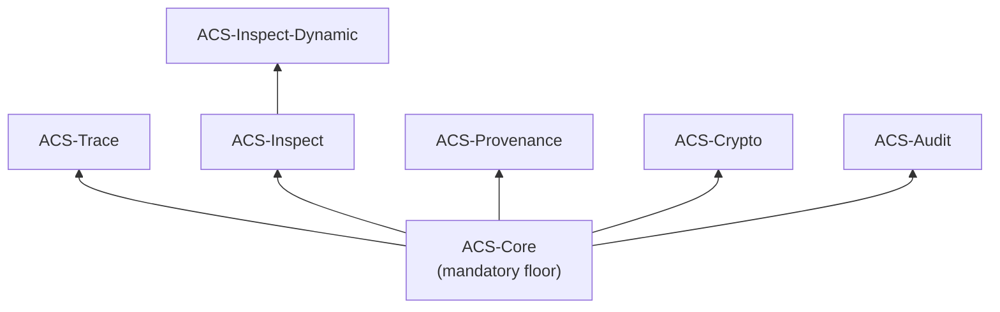

# Conformance Profiles

ACS v0.1.0 conformance is tiered. Every conformant deployment implements **ACS-Core** — the mandatory baseline below. Trace event emission, AgBOM serialization, field-level provenance, cryptographic signatures, and strengthened audit chains are organized as **profiles** that deployments declare independently in the [handshake](./instrument/specification.md#4-capability-negotiation-handshake).

The profile system lets a small harness ship a useful subset of ACS quickly, while a more capable deployment can layer on observability, supply-chain inventory, or cryptographic integrity without changing the wire format.

## Profile declaration

Profiles are declared in the handshake. ClientHello includes `profiles_supported: string[]`; ServerHello includes `profiles_accepted: string[]`. Profile names are the lowercase hyphenated forms below: `acs-core`, `acs-trace`, `acs-inspect`, `acs-inspect-dynamic`, `acs-provenance`, `acs-crypto`, `acs-audit`.

A Guardian MAY refuse a session if the client does not declare a profile the Guardian's policy requires (e.g. a Guardian whose policy needs provenance MAY refuse a client that does not declare `acs-provenance`).

The diagram below shows the six optional profiles layering on the mandatory ACS-Core floor. Each layer is a self-declared claim from the handshake, not a verified fact.

## ACS-Core (mandatory baseline)

A v0.1.0-conformant deployment MUST implement ACS-Core. ACS-Core comprises:

- **Handshake** — `handshake/hello` with ClientHello/ServerHello ([Specification §4](./instrument/specification.md#4-capability-negotiation-handshake)).
- **Request/response envelope** — JSON-RPC 2.0 with ACS extensions ([§3](./instrument/specification.md#3-wire-format)). `request_id`, `timestamp`, `acs_version`, `metadata` required on every request.
- **Hook taxonomy** — At minimum: `sessionStart`, `userMessage` or `agentTrigger`, `toolCallRequest`, `toolCallResult`, `agentResponse`, `sessionEnd`, `subagentStart`. A subagent-capable client MUST emit `subagentStart` when it spawns a sub-agent; a client whose framework has no sub-agent abstraction has nothing to emit. The Guardian determines client subagent-emission capability by deployment-defined means (agent identity bound at handshake, policy keyed on `agent_id`, organizational configuration), mirroring the ASK precedent in [§9.2](./instrument/specification.md#92-approver-incapable-clients-normative). Without `subagentStart`, a Guardian is blind to cross-agent propagation (the confused-deputy attack class). `subagentStop` is SHOULD-emit (audit-only, not decision-eligible; its `final_chain_hash` field is optional for frameworks maintaining no session-chain — see [`subagent-stop.json`](https://genai-security-project.github.io/agent-control-standard/schema/v0.1.0/hooks/subagent-stop.json)). Additional hooks (`turnStart`/`turnEnd`, `preCompact`/`postCompact`, `knowledgeRetrieval`, `memoryContextRetrieval`, `memoryStore`, `skillRegister`/`skillLoad`/`skillUnload`) are normatively defined and SHOULD be implemented when the harness can observe the corresponding event; they are capability-negotiated via the handshake. A deployment whose AgBOM includes `skill` components SHOULD emit the skill lifecycle hooks, so a Guardian is not blind to a composition surface the inventory already exposes.
- **Dispositions** — Four MUST-support: ALLOW, DENY, ASK, DEFER, with required fields per [§6](./instrument/specification.md#6-disposition-vocabulary). MODIFY is SHOULD-support: deployments that implement MODIFY MUST follow the MODIFY composition rules ([§6.3](./instrument/specification.md#63-modify-composition-normative)); deployments that do not implement MODIFY are handled per [§6.5](./instrument/specification.md#65-modify-incapable-clients-normative) (the Guardian substitutes `DENY` with `reason_codes: ["modify_unsupported"]` and an audit event recording the substitution, determined by deployment-defined means rather than a wire declaration, mirroring the §9.2 precedent for ASK).
- **SessionContext and Intent**: `session_id`, `chain_hash` (rolling SHA-256), append-only ContextEntry chain, with the Guardian publishing the chain head (`chain_hash`) on responses for content-bearing steps ([§8](./instrument/specification.md#8-sessioncontext-and-intent)). Intent is optional; when a deployment uses Intent (for example, under an IBAC-style policy), its immutability and extension rules ([§8.4](./instrument/specification.md#84-intent), [§9.1](./instrument/specification.md#91-intent-extension-via-ask-normative)) are normative.
- **Replay protection** — `request_id` (UUID) and `timestamp` on every request; Guardians MUST reject replays per [§10.3](./instrument/specification.md#103-replay-protection).
- **Baseline integrity**: every request and response carries a signature over the canonical envelope ([§10](./instrument/specification.md#10-cryptographic-signatures)). `HMAC-SHA256` with an HKDF-derived per-session key from deployment-provided key material is the baseline; asymmetric and post-quantum algorithms are the ACS-Crypto profile.
- **Decision honoring**: the Observed Agent MUST wait for the Guardian's decision up to the negotiated timeout and apply it; on a decision failure (timeout, transport failure, or an error without a decision) it applies the `on_decision_failure` posture (default `proceed`, fail-open) and records every decision failure as an audit event, fail-open or fail-closed ([§6.4](./instrument/specification.md#64-honoring-decisions-normative)). Handshake failure follows the deployment's startup posture ([§4.1](./instrument/specification.md#41-handshake-failure-normative)).
- **Liveness** — `system/ping` SHOULD be implemented: the Observed Agent declares it in `methods_implemented` and sends it, and the Guardian answers it per [§13](./instrument/specification.md#13-liveness-system-methods). A deployment MAY omit it only if the Observed Agent relies on an alternative liveness mechanism that the deployment's configuration names (for example: TCP keepalive or HTTP/2 PING on HTTP transports; process supervision or an out-of-band heartbeat on stdio; or continuous observed hook traffic where the session's own cadence acts as the probe). ACS does not put that declaration on the wire in v0.1, as [§9.2](./instrument/specification.md#92-approver-incapable-clients-normative) does not for approver capability. Omitting `system/ping` without a declared alternative is non-conformant: the chain of defaults (`startup_posture: proceed`, `on_decision_failure: proceed`, no liveness) produces silent fail-open on Guardian outage, which the Core baseline cannot allow.
- **Wrapped MCP** — `protocols/MCP/*` ([Hooks](./instrument/hooks.md#protocolsmcp)) MUST be implemented by deployments whose sessions involve MCP at any point (tools, resources, prompts, notifications), so that `protocols/MCP/resources/read` — the canonical prompt-injection ingress for attacker-controlled external content — is not bypassed. MCP `tools/call` MAY instead flow through the generic `steps/toolCallRequest` / `steps/toolCallResult` hooks when tool-level policy suffices; the requirement exists for the surfaces the generic hooks cannot see (capability negotiation, prompt fetches, resource reads, notifications). Support is declared in the handshake via `wrapped_protocols`. Deployments whose sessions never involve MCP MAY omit the namespace. **Known v0.1 limitation:** `wrapped_protocols` is declared once, at handshake, and v0.1 defines no renegotiation. A session that declared no MCP and then gains an MCP server mid-session (a mutation `agbom/changed` reports, and the `acs-inspect-dynamic` profile exists to surface) cannot begin wrapping mid-session: the generic tool hooks still govern that server's tool calls, the addition is visible through `agbom/changed`, and wrapped coverage begins at the next session's handshake. Renegotiation is v0.2 scope.

!!! note "Decided, not yet in this text"
    The **Decision honoring** item above still reads default `proceed`, as [§6.4](./instrument/specification.md#64-honoring-decisions-normative) does. The leads decided that deny becomes the default and the startup posture follows ([D-036](../decisions/index.md#d-036-default-the-failure-posture-to-deny)), that only the Observed Agent's own configuration can opt into `proceed` ([D-045](../decisions/index.md#d-045-only-the-observed-agents-own-configuration-can-opt-into-proceed)), and that a refusal or an integrity failure blocks the step whatever the posture says ([D-040](../decisions/index.md#d-040-split-decision-failures-from-refusals)). The specification text has not changed yet. In release 0.1.5, the adapters, the gateway, the example Guardian and the Go Guardian already default to deny, and the TypeScript Guardian declares `proceed` ([What runs in release 0.1.5](./instrument/README.md#what-runs-in-release-015)).

    The **Wrapped MCP** item applies to the reference adapters too. They send MCP tool calls through `steps/toolCallRequest` and `steps/toolCallResult` and send nothing for the other MCP surfaces, so a session that uses MCP falls short of ACS-Core on those surfaces.

ACS-Core does NOT require: field-level Provenance objects, Trace event emission, AgBOM, asymmetric or post-quantum signatures, or `request_hash` on ContextEntry (`request_hash` remains SHOULD). It DOES require the baseline signature (§10) and decision honoring (§6.4). ACS-Core deployments validate hook payloads against the base schemas, where `provenance` is OPTIONAL; field-level Provenance is added by the ACS-Provenance profile.

What "ACS-Core conformant" guarantees: the channel is authenticated and the Observed Agent honors the Guardian's decisions on the four MUST-support dispositions (ALLOW, DENY, ASK, DEFER). Deployments that also implement MODIFY (SHOULD-support, [§6.5](./instrument/specification.md#65-modify-incapable-clients-normative)) honor it too; deployments that do not implement MODIFY receive `DENY` substitutions carrying `reason_codes: ["modify_unsupported"]` instead, except at `postCompact`, where they receive `ALLOW` and the Guardian records an audit event carrying that reason code (§6.5). A minimum-conformant deployment can therefore permit or refuse an action but cannot alter it — redaction and other content rewrites require MODIFY support. This clause does NOT assert that a deployment's policies are strict, nor that the audit chain is tamper-evident against a compromised Guardian (that is the ACS-Crypto and ACS-Audit profiles, since the HMAC baseline is symmetric). A permissive Guardian is a conformant but permissive deployment, not a violation.

Who verifies a conformance claim: nobody, in v0.1.0. `profiles_supported` and `profiles_accepted` are self-declaration on the wire. No registry of conformant implementations exists, and no steward body arbitrates a disputed claim. A deployment that advertises "ACS-Core conformant" is asserting that about itself, and a buyer who procures on that basis is trusting the implementer rather than a third party. Test the deployment against the requirements above the way you would check any other vendor claim.

Release 0.1.5 ships test suites for its own reference implementations: the adapters' [emission-conformance check](https://github.com/GenAI-Security-Project/agent-control-standard/blob/main/adapters/README.md#the-acs-v010-emission-conformance-check), the TypeScript Guardian's `bun run conformance` harness ([Verify](https://github.com/GenAI-Security-Project/agent-control-standard/blob/main/reference-implementations/agt/README.md#verify)), and the Go Guardian's [conformance map](https://github.com/GenAI-Security-Project/agent-control-standard/blob/main/reference-implementations/agt-go/docs/conformance.md). Each one runs ACS-Core checks, or emission checks, against its own reference stack at summary level. None of them verifies a deployment's claim requirement by requirement, and a pass does not make a deployment conformant. No official ACS-Core conformance suite exists yet. One is planned on the roadmap, and when it exists it will live in this repository and version with the specification ([D-019](../decisions/index.md#d-019-keep-the-conformance-suite-in-this-repository)). To record a claim, use the [conformance claim template](./conformance-claim-template.md).

## ACS-Trace

Adds deterministic Trace event emission per [Trace Events](./trace/events.md). A deployment claiming ACS-Trace MUST:

1. Emit at least one of {OTel, OCSF} for every supported ACS step, with the required attributes populated and each conditional attribute populated whenever its source field is present.
2. Record decisions as Trace events.
3. Carry provenance facts forward onto Trace events.

Required for deployments that need cross-vendor observability or SIEM integration. Trace events MUST NOT block enforcement.

## ACS-Inspect

Adds AgBOM snapshot emission per [Inspect](./inspect/README.md). A deployment claiming ACS-Inspect MUST:

1. Emit `agbom/snapshot` once per session before content-bearing hooks fire.
2. Have the Guardian serialize the canonical AgBOM into at least one of {CycloneDX 1.6, SPDX 3.0, SWID} on request.

Required when Guardian policy depends on component inventory.

### ACS-Inspect-Dynamic (extends ACS-Inspect)

Adds `agbom/changed` emission on every mid-session component mutation, with audit-chain integration. Required for deployments where agents hot-swap models, tools, or MCP servers.

## ACS-Provenance

Adds field-level Provenance objects ([§7](./instrument/specification.md#7-provenance)) to data-bearing fields. A deployment claiming ACS-Provenance runs `provenance_producer: deterministic` and MUST attach a Provenance object to every data-bearing field in every hook payload it emits, populating `provenance_id`, `origin`, and (when applicable) `derived_from`. Payloads are validated against the strict `*.acs-provenance.json` variant of each data-bearing hook, which restores `provenance` to the required set; ACS-Core deployments validate against the permissive base schema. Partial population within a producing session is non-conformant.

The wire-format `trust` enum is OPTIONAL in v0.1; the v0.1 expected practice is for Guardians to derive trust from `origin` + `source_id` against local policy without populating the field. Vendor Guardian implementations that elect to populate `trust` on the wire MUST enforce the monotonicity rule on `agent_generated` trust and SHOULD use the default channel-to-trust mapping ([§7.2](./instrument/specification.md#72-default-channel-to-trust-mapping)) so cross-deployment audits remain portable.

Required when deployment policy depends on data lineage or trust classification (for example, FIDES-, CaMeL-, or cumulative-context AARM-style policies — whether trust is materialized on the wire or derived in policy). Not required for deployments that enforce only identity, role, resource, or Intent-based rules. See [Authorization Paradigms](../topics/authorization-paradigms.md).

## ACS-Crypto

Adds cryptographic signature support beyond the baseline's replay-protection fields. A deployment claiming ACS-Crypto MUST support at least `ML-DSA-65` (RECOMMENDED primary) and SHOULD support `SLH-DSA-128s` as an algorithmic-diversity backup. Hybrid composites (`ML-DSA-65+ECDSA-P256`, `ML-DSA-65+RSA-PSS-SHA256`) are OPTIONAL for transitional deployments.

ACS-Core requires a baseline signature; `HMAC-SHA256` over the canonical envelope ([§10](./instrument/specification.md#10-cryptographic-signatures)) satisfies it. ACS-Crypto replaces or augments the baseline with asymmetric and post-quantum algorithms, which add the non-repudiation and external verifiability the symmetric baseline cannot give. Transport-level security alone does not satisfy the Core signature requirement: it does not bind a message for audit, or across multi-hop A2A and multi-Guardian paths.

Policy-author identity is distinct from both Observed Agent identity and Guardian identity. v0.1 keeps policy-author authorization and trust schemes deployment-defined, but `policy_references[].policy_version` gives replay and ledger-backed deployments a stable pointer to the policy state that was evaluated. A future Policy Attestation profile is expected to bind policy references to verifiable author signatures using algorithms from the ACS-Crypto registry while leaving the deployment trust scheme (for example SPIFFE, OIDC, DID, organizational PKI, or quorum signing) out of the core wire contract.

## ACS-Audit

Strengthens the audit chain beyond ACS-Core's baseline. A deployment claiming ACS-Audit MUST populate `request_hash` (lowercase-hex SHA-256 of JCS-canonicalized request params) on every ContextEntry, ensuring the chain commits to request content, not just step metadata. ACS-Audit deployments SHOULD also populate `timestamp` and `provenance_summary` on every ContextEntry.

## Profile combinations

Profiles compose. A deployment that wants full observability and supply-chain inventory but not asymmetric or post-quantum signatures (it keeps the Core HMAC baseline) declares `["acs-core", "acs-trace", "acs-inspect", "acs-provenance"]`. A high-assurance deployment declares all of `["acs-core", "acs-trace", "acs-inspect", "acs-inspect-dynamic", "acs-provenance", "acs-crypto", "acs-audit"]`. A minimal IDE harness declares `["acs-core"]` only.

## Quick reference

| Profile | What it adds | When to claim |
|---|---|---|
| `acs-core` | Handshake, envelope, minimum hook set (incl. `subagentStart` for subagent-capable clients), four MUST-support dispositions (ALLOW/DENY/ASK/DEFER) with MODIFY SHOULD-support (§6.5), SessionContext + published chain head, replay protection, baseline signature (HMAC-SHA256), decision honoring, declared liveness mechanism, Wrapped MCP when sessions involve MCP | Always (mandatory) |
| `acs-trace` | OTel or OCSF Trace events per supported step, decisions and provenance included | Cross-vendor observability or SIEM integration |
| `acs-inspect` | `agbom/snapshot` + canonical AgBOM serialization | Policy depends on component inventory |
| `acs-inspect-dynamic` | `agbom/changed` on mutation | Agent hot-swaps components mid-session |
| `acs-provenance` | Field-level Provenance objects | Policy depends on data lineage (e.g., FIDES, CaMeL, or cumulative-context AARM-style rules) |
| `acs-crypto` | ML-DSA-65 / SLH-DSA-128s signatures | Cryptographic integrity beyond shared-secret HMAC |
| `acs-audit` | `request_hash` on every ContextEntry | Chain must commit to request content |
