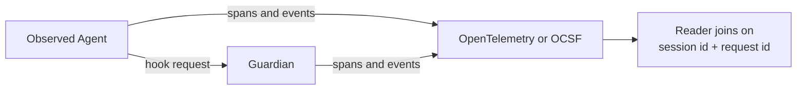

# OWASP Agent Control Standard - Trace

AI agents make autonomous decisions that impact business outcomes. Without observability, enterprises can't understand, trust, or control these decisions.

**Transform agent black boxes into transparent, auditable systems through comprehensive tracing.**

!!! info "ACS Extends Industry Standards"
    We already have great observability standards, so ACS doesn't introduce a new one. Instead, it extends existing industry-proven standards: OpenTelemetry and OCSF to support AI agent-specific components.

## Where Trace Sits

Instrument decides in the moment. Trace records what happened, out of the request path, so someone can rebuild a session afterwards: what the agent tried, what the Guardian decided, and which steps got no usable decision at all.

Both parties write to the trace, because each one sees something the other can't. In the diagram, notice that the Observed Agent and the Guardian each emit their own stream, and the two streams meet only at the reader.

The reader matches records from the two parties by each step's session id and request id. [Trace Events](./events.md) defines that join and the rule for counting a decision as enforced. To see it as real files, read [How the reference Guardian produces a trace](./extend_opentelemetry.md#how-the-reference-guardian-produces-a-trace), or open the committed [sample trace](https://github.com/GenAI-Security-Project/agent-control-standard/blob/main/reference-implementations/agt/samples/trace/acs-trace-sample.jsonl).

## Why Agent Observability Matters

Modern agents orchestrate complex workflows: reasoning chains, tool execution, knowledge retrieval, multi-agent collaboration. When things go wrong, or right, you need to understand exactly what happened.

**The Problem**: Agents operate autonomously with complex internal logic. Traditional monitoring can't capture reasoning processes or decision context.

**The Solution**: Comprehensive observability that traces every agent action from trigger to outcome, with full reasoning context.

## Observability Goals

**Transparency**: Complete reconstruction of agent behavior. See not just what agents did, but why they made each decision.

**Security**: Detect anomalous behavior in real-time. Trace attack vectors across multi-agent systems. Enforce policies at decision points.

**Performance**: Identify bottlenecks in reasoning chains. Optimize tool usage patterns. Monitor resource consumption across agent workflows.

**Trust**: Observable, reconstructable audit trails for regulatory compliance. Trace events are self-reported observations produced inside the environment being observed; they become evidence only when a party outside the emitting runtime attests to them (see the verifier-side discussion in issue #18). Explainable decisions for stakeholder confidence.

## How It Works

ACS provides specification for detailed tracing of agent behavior. Traces are implemented via extensions of proven industry standards:

| Standard | ACS Spec | Status |
|--|--|--|
| [OpenTelemetry](https://opentelemetry.io/) | [ACS with OpenTelemetry](./extend_opentelemetry.md) | Working draft |
| [OCSF](https://ocsf.io/) | [ACS with OCSF](./extend_ocsf.md) | Working draft |

## Read Next

- [Supported Events](./events.md)