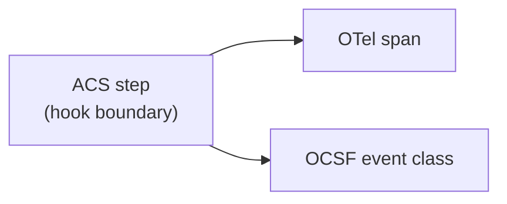

# Trace Events

Every agent step that produces an ACS hook is recordable as a Trace event. The Trace pillar is decoupled from enforcement and runs out of the request/response path: deployments emit OpenTelemetry spans (over OTLP/gRPC or OTLP/HTTP) and/or OCSF events to existing observability backends. ACS does not redefine a trace transport. Its normative contribution is the **vocabulary** — span names, attribute keys, event classes, severity/disposition mapping — that ensures cross-vendor agents and Guardians produce comparable traces.

Trace emission is the subject of the **ACS-Trace** [conformance profile](../conformance.md#acs-trace). Deployments that implement only ACS-Core (Instrument) without Trace are v0.1.0-conformant but do not claim ACS-Trace.

The diagram below shows one ACS step mapping in parallel into an OTel span and an OCSF event class. Neither mapping depends on the other.

Every attribute value comes from the Observed Agent, the Guardian, or content they processed, and any of it can carry text an attacker influenced. A consumer that renders trace data or feeds it to a model SHOULD treat every trace value, in OTel attributes or OCSF fields, as untrusted data, never as instructions or markup.

## OpenTelemetry semantic conventions

Each ACS step produces a span whose `name` and required attributes are fixed by the table below. Decisions are recorded as span events on the parent step span, not as separate spans, so the enforcement verdict and the action it gates share a parent.

An attribute marked *conditional* comes from a field the hook payload or response may omit. An exporter MUST emit it whenever the source field is present and MUST omit it when the field is absent. An empty source array counts as absent.

The full mapping lives in [`trace/otel-mapping.json`](https://genai-security-project.github.io/agent-control-standard/schema/v0.1.0/trace/otel-mapping.json). See [Extending OpenTelemetry](./extend_opentelemetry.md) for a deeper integration guide.

| ACS step | OTel span name | Required attributes |
|---|---|---|
| `steps/sessionStart` | `acs.session` | `acs.session.id`; `acs.tenant_id` if set |
| `steps/agentTrigger` | `acs.agent.trigger` | `acs.agent.id`, `acs.trigger.type` |
| `steps/userMessage` | `acs.message.user` | `acs.session.id`, `acs.content.types[]` |
| `steps/agentResponse` | `acs.message.agent` | `acs.session.id`, `acs.agent.id` |
| `steps/toolCallRequest` | `gen_ai.tool.call` | `gen_ai.tool.name`; `acs.capability` (conditional); `acs.tool.provider` (optional) |
| `steps/toolCallResult` | `gen_ai.tool.result` | `gen_ai.tool.name`, `acs.exit_status`; `acs.request_id_ref` (conditional); `acs.duration_ms` (optional) |
| `steps/knowledgeRetrieval` | `acs.knowledge.retrieval` | `acs.results.count`; `acs.source.type` (conditional) |
| `steps/memoryStore` | `acs.memory.store` | `acs.memory_store.name`, `acs.operation` (both conditional) |
| `steps/memoryContextRetrieval` | `acs.memory.retrieval` | `acs.results.count`; `acs.memory_store.name` (conditional) |
| `steps/sessionEnd` | `acs.session.end` | `acs.session.reason` |
| `steps/turnStart`, `steps/turnEnd` | `acs.turn`, `acs.turn.end` | `acs.turn.id`, `acs.turn.triggered_by` / `acs.turn.outcome` |
| `steps/preCompact` | `acs.compact` | `acs.compact.entry_count`, `acs.compact.triggered_by` |
| `steps/postCompact` | `acs.compact.complete` | `acs.compact.entry_count`; `acs.compact.lineage_depth_after` (optional) |
| `steps/subagentStart`, `steps/subagentStop` | `acs.subagent`, `acs.subagent.end` | `acs.subagent.session_id`, `acs.subagent.parent_session_id`, `acs.subagent.intent_derivation` / `acs.subagent.outcome`; `acs.subagent.final_chain_hash` (conditional) |
| `steps/skillRegister` | `acs.skill.register` | `acs.skill.id`, `acs.skill.digest.algorithm`, `acs.skill.digest.value`, `acs.skill.declared_capabilities` |
| `steps/skillLoad` | `acs.skill.load` | `acs.skill.id`, `acs.skill.digest.algorithm`, `acs.skill.digest.value`, `acs.skill.load_trigger`, `acs.skill.load_path` (skill ids, root first); `acs.skill.digest_verified`, `acs.skill.registration_ref` (optional) |
| `steps/skillUnload` | `acs.skill.unload` | `acs.skill.id`, `acs.skill.reason`; `acs.skill.replaced_by` (optional) |
| Decision (allow/deny/modify/ask/defer) | `acs.decision` (span event) | `acs.decision`; `acs.evaluator`, `acs.evaluator_version`, `acs.model_id`, `acs.reasoning`, `acs.confidence`, `acs.reason_codes`, `acs.policy.ids`, `acs.policy.versions`, `acs.policy.rule_ids`, `acs.cited_provenance_ids`, `acs.chain_hash` (conditional) |
| Decision failure | `acs.decision.failure` (span event; on the `acs.session` span for `handshake_failure`) | `acs.failure.class`, `acs.failure.posture`, `acs.failure.reported_by`; `acs.failure.detail` (required for class `other`), `acs.failure.error_code`, `acs.failure.timeout_ms`, `acs.failure.elapsed_ms`, `acs.failure.payload_bytes` (conditional) |
| `agbom/snapshot` | `acs.agbom` | `acs.agbom.format`, `acs.agbom.component_count` |
| `agbom/changed` | `acs.agbom` | `acs.agbom.format`; `acs.agbom.change_reason` (conditional) |

Every step span also carries `acs.request_id` and `acs.session.id`, the step's own `request_id` and `session_id`. A `steps/toolCallResult` span's `acs.request_id_ref` joins to its request. The Observed Agent chooses `request_id`, and it is unique only within a session ([Specification §10.3](../instrument/specification.md#103-replay-protection)), so a join keys on the two together. The Observed Agent and the Guardian may each emit a span for one request, and a reader joins the two. When the Observed Agent retries a step with a new `request_id`, each attempt is its own request. The Observed Agent emits a step span for each attempt that reached the Guardian, carrying that attempt's `request_id`. A Guardian event whose pair matches no Observed Agent step span is a discrepancy worth investigating.

The three `acs.policy.*` attributes are parallel arrays built from `policy_references`. Their source field is `policy_references` itself: all three are emitted whenever the response carries a non-empty `policy_references`, and none otherwise. Each has the same length and order as `policy_references`, with `""` where an entry lacks the field. A reader can then line up a policy, its version, and its rule by position. A `""` on the wire could not be told from an absent field, so the response envelope rejects one in a `policy_references` entry, and the Provenance schema rejects an empty `source_id`. A producer SHOULD omit a member it has no value for rather than send `""`, because a peer validating against these schemas now rejects the empty string. `acs.reason_codes` is a set. Its order carries no meaning, and it does not line up with the policy arrays.

An `acs.decision` event records the Guardian's verdict. Only the Observed Agent knows the applied outcome. When any `acs.decision.failure` event in either party's stream carries the same `acs.session.id` and `acs.request_id`, a reader MUST NOT count the `acs.decision` event as an enforced outcome. The rule works in one direction only. A missing failure event does not prove the decision was enforced, because in v0.1 the Observed Agent can under-report, so no decision event proves enforcement on its own. `acs.chain_hash` is a copy of the response field and proves nothing on its own. The trace carries neither the response signature nor the ContextEntries a verifier needs ([Specification §8.6](../instrument/specification.md#86-chain-head-publication-normative)). One check does work from the trace alone: when the Guardian's and the Observed Agent's streams show different `acs.chain_hash` values for the same `acs.session.id` and `acs.request_id`, that is an integrity event under §8.6.

A decision failure gets its own event because it has no disposition and no evaluator. It goes on the step span, except `handshake_failure`, which goes on the `acs.session` span: the session started without a completed handshake, so none of its steps was governed. `signature_invalid` is a response whose signature failed verification, kept apart from `malformed_response` so a tampered response does not blend into organic failures. The Observed Agent MUST record every decision failure, fail-open or fail-closed, in the deployment's own audit log. It SHOULD emit `acs.decision.failure` when it claims ACS-Trace. A Guardian claiming ACS-Trace SHOULD emit the event for the failures it sees itself: an error it returned (`guardian_error`) and a decision it finished after the negotiated timeout (`timeout`). The mapping lists every class and posture value.

In v0.1 the Observed Agent reports this event about its own conduct. A missing event does not show that no failure happened, and a count built from these events is a lower bound. Events from both parties for one request describe one failure, so a reader counts distinct `acs.session.id` and `acs.request_id` pairs. That counts failed attempts, not steps: a step the Observed Agent recovered by retrying still shows its failed attempts. A pair with a Guardian event and no Observed Agent event still counts. A Guardian MUST NOT emit the event for a request it rejects as a replay (`REPLAY_DETECTED`), because that pair belongs to the earlier request. `acs.failure.detail` MUST be text the emitter composes itself, and MUST NOT copy bytes from the request, the response, or an error's `data`.

Some unusable responses are not decision failures, because the spec already defines their outcome. A response whose `modifications` break §6.3 gets `DENY`, whether or not schema validation also rejects it. A `MODIFY` the client cannot apply gets `DENY`, or at `postCompact` the original summary (§6.5). `malformed_response` covers a response that does not parse, or that fails schema validation for any other reason.

No AgBOM payload carries a format field, because the Observed Agent always sends the canonical form. An exporter recording the payload sets `acs.agbom.format` to `canonical`. A Guardian recording a serialization it rendered sets the value it advertises in the handshake's `agbom_serializations_supported` (`cyclonedx-1.6`, `spdx-3.0`, or `swid`).

When Provenance is attached to a hook payload, the resulting span MUST carry `acs.provenance.origin` as an attribute, and SHOULD carry `acs.provenance.source_id` when populated. Both are string arrays, also for a single Provenance object. `acs.provenance.source_id` is emitted whenever at least one attached object has a `source_id`. It then has the same length and order as `acs.provenance.origin`, with `""` where an object has none. v0.1 emits factual provenance attributes. Trust classification is computed by the Guardian against local policy and is not a v0.1 span attribute (see [Specification §7](../instrument/specification.md#7-provenance)). Provenance lineage edges MAY be linked via OTel span links keyed by `provenance_id`.

## OCSF event classes

Each ACS step is representable as an OCSF event in the class shown below (OCSF 1.9.0). Required class-specific attributes are populated from the ACS payload.

The full mapping lives in [`trace/ocsf-mapping.json`](https://genai-security-project.github.io/agent-control-standard/schema/v0.1.0/trace/ocsf-mapping.json). See [Extending OCSF](./extend_ocsf.md) for the deeper integration guide.

| ACS step | OCSF class | Class UID |
|---|---|---|
| `steps/sessionStart` | Authentication | 3002 |
| `steps/agentTrigger`, `steps/userMessage`, `steps/agentResponse` | Application Lifecycle | 6002 |
| `steps/toolCallRequest`, `steps/toolCallResult` | Process Activity | 1007 |
| `steps/skillLoad`, `steps/skillUnload` | Module Activity | 1005 (`activity_id` 1 load, 2 unload) |
| `steps/knowledgeRetrieval`, `steps/memoryStore`, `steps/memoryContextRetrieval` | Datastore Activity | 6005 |
| `steps/preCompact`, `steps/postCompact` | Datastore Activity | 6005 (compaction subtype) |
| `steps/subagentStart`, `steps/subagentStop` | Authentication | 3002 (logon/logoff for the subagent's session) |
| `steps/turnStart`, `steps/turnEnd` | Application Lifecycle | 6002 |
| Decision (deny/modify/ask/defer) | Detection Finding | 2004 |
| `agbom/snapshot`, `agbom/changed` | Device Inventory Info | 5001 (`activity_id` 2, Collect) |
| `steps/skillRegister` | Device Inventory Info | 5001 (`activity_id` 2, Collect: skill enters the component set) |
| `steps/sessionEnd` | Authentication | 3002 (logoff) |

OCSF `severity_id` for decision events is set from the disposition:

| Disposition | `severity_id` |
|---|---|
| `allow` | 1 (Informational) |
| `modify` | 2 (Low) |
| `ask` | 3 (Medium) |
| `defer` | 3 (Medium) |
| `deny` | 4 (High) |

OCSF `action_id` and `disposition_id` for decision events are also set from the disposition. They come from OCSF's Security Control profile, so a decision event lists `security_control` in `metadata.profiles`. Both record the Guardian's verdict, so an `action_id` of 2 (Denied) or a `disposition_id` of 2 (Blocked) never proves the action was blocked, and the enforcement rule above applies to OCSF decision events as well. OCSF has no `disposition_id` for `modify` or `ask`. `defer` takes 99 (Other) as well, not 14 (Delayed), because an ACS defer holds the step and denies by default when it times out. `action_id` gives `modify` its own code, 4 (Modified). `ask` and `defer` share 99 in both, so the `action` and `disposition` text fields are required too. They carry the OCSF caption for 1, 2 and 4, and the ACS name for 99. The `allow` row applies when the deployment records allows as Detection Findings.

| Disposition | `action_id` | `disposition_id` | `is_alert` |
|---|---|---|---|
| `allow` | 1 (Allowed) | 1 (Allowed) | false |
| `deny` | 2 (Denied) | 2 (Blocked) | true |
| `modify` | 4 (Modified) | 99 (Other) | false |
| `ask` | 99 (Other) | 99 (Other) | true |
| `defer` | 99 (Other) | 99 (Other) | true |

On an on-time decision event, `is_alert` is true exactly when `severity_id` is 3 or higher, so the two fields never disagree. `ask` and `defer` alert because an ASK can time out to `allow`, a DEFER can fall back to that ASK, and v0.1.0 has no Trace event for how either one ends, so the decision event is the only signal a SOC gets. `modify` does not alert, because the action ran in the form the policy required, and a MODIFY the client cannot apply becomes a DENY (§6.5), which alerts.

A Guardian SHOULD NOT set `verdict_id` or the finding's `status_id`, because both belong to whoever triages the finding.

SIEM content reads native fields, not `unmapped`, so each decision event also carries these:

- `metadata.correlation_uid` is the gated step's pair, formatted as `<session_id>:<request_id>`. Every OCSF step event sets it from its own pair too, so the join works on native fields alone.
- `evidences` holds the agent and the action, because a Detection Finding has no other native place for them: `ai_agent.uid` from `metadata.agent_id`, `actor.session.uid` from `metadata.session_id`, and, for `steps/toolCallRequest` and `steps/toolCallResult`, the action the decision gates as `api.operation`, set to the tool name. For every other step, `evidences` carries `ai_agent` and `actor.session` only.
- `authorizations` has one entry per `policy_references` entry, in the same order, whenever `policy_references` is non-empty. Each entry's `policy` carries `uid`, `version` and `name` from `policy_id`, `policy_version` and `policy_name`. An entry with neither `policy_id` nor `policy_name` MUST be an `authorizations` entry with no `policy` object, so positions still line up with `policy_references`: OCSF requires a `policy` to carry `uid` or `name`.
- `finding_info.desc` SHOULD carry `reasoning`.

The decision's `request_id`, `decision`, `reasoning`, `reason_codes`, `policy_references`, `cited_provenance_ids`, `chain_hash`, and `metadata` also ride under `unmapped.acs` with the response's field names, as the exact copy for replay. Every OCSF step event carries `unmapped.acs.request_id` and `unmapped.acs.session_id`. The decision event carries the gated step's pair (`join_fields` in the mapping). A `steps/toolCallResult` event also carries `unmapped.acs.request_id_ref` when the payload has it. OCSF does not validate `unmapped`, so each field takes the type of its definition in the response envelope.

A Guardian that finishes a decision after the negotiated timeout still emits the decision event. A late deny under fail-open means the policy said no and the action ran, so suppressing it would leave OCSF silent exactly when someone slows the Guardian down. `action_id` and `disposition_id` stay the verdict. `finding_info.types` includes `late_decision_fail_open` or `late_decision_fail_closed`, from the `on_decision_failure` posture the Guardian sent in its ServerHello. `unmapped.acs.failure` carries `class`, `posture`, `timeout_ms`, `elapsed_ms` and `payload_bytes`, with the values of the matching `acs.failure.*` attributes. `is_alert` follows the table above, and is also true for any verdict other than `allow` under fail-open, because the action ran without what the policy required. `severity_id` stays the value the table gives the verdict, so a late decision is the one case where `is_alert` can be true below severity 3. A reader MUST NOT count a decision event whose `finding_info.types` includes `late_decision_fail_open` or `late_decision_fail_closed` as an enforced outcome. The Guardian measures its own processing time, not network time, so a decision can still arrive late and look on time. This is the first piece of an OCSF form for decision failures. v0.1.0 defines none for the other failure classes.

## ACS-Trace conformance bar

A deployment claiming **ACS-Trace** MUST:

1. Emit at least one of {OTel, OCSF} for every ACS step the deployment supports, with the required attributes populated and each conditional attribute populated whenever its source field is present.
2. Record every decision as a Trace event carrying the disposition, plus the evaluator identity and reasoning when the response carries them.
3. Carry provenance facts forward from the hook payload onto the Trace event. Carry the decision's reason codes, policy references, cited provenance ids, and chain hash onto the decision event when the response carries them. Arrays follow the padding rules above. A reader can then tell which policies, rules, and reason codes produced a decision without consulting Guardian state. Joining a cited provenance id to its provenance facts, and verifying the chain head, still need the Guardian's ContextEntries and the signed response.

Trace events MUST NOT block enforcement — failure of the Trace sink MUST NOT change the disposition returned to the Observed Agent. Deployments that do not claim ACS-Trace SHOULD still emit Trace events where feasible; the vocabulary is normative regardless of profile claim.
