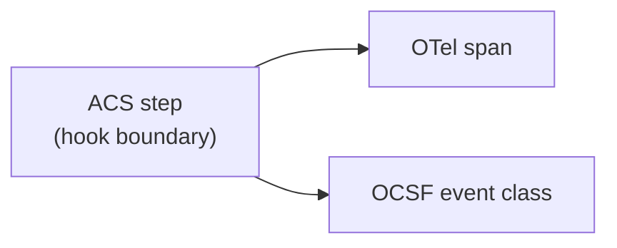

# Trace Events

Every agent step that produces an ACS hook is recordable as a Trace event. The Trace pillar is decoupled from enforcement and runs out of the request/response path: deployments emit OpenTelemetry spans (over OTLP/gRPC or OTLP/HTTP) and/or OCSF events to existing observability backends. ACS does not redefine a trace transport. Its normative contribution is the **vocabulary** — span names, attribute keys, event classes, severity/disposition mapping — that ensures cross-vendor agents and Guardians produce comparable traces.

Trace emission is the subject of the **ACS-Trace** [conformance profile](../conformance.md#acs-trace). Deployments that implement only ACS-Core (Instrument) without Trace are v0.1.0-conformant but do not claim ACS-Trace.

The diagram below shows one ACS step mapping in parallel into an OTel span and an OCSF event class. Neither mapping depends on the other.

## OpenTelemetry semantic conventions

Each ACS step produces a span whose `name` and required attributes are fixed by the table below. Decisions are recorded as span events on the parent step span, not as separate spans, so the enforcement verdict and the action it gates share a parent.

An attribute marked *conditional* comes from a field the hook payload or response may omit. An exporter MUST emit it whenever the source field is present and MUST omit it when the field is absent. An empty source array counts as absent.

The full mapping lives in [`trace/otel-mapping.json`](https://genai-security-project.github.io/agent-control-standard/schema/v0.1.0/trace/otel-mapping.json). See [Extending OpenTelemetry](./extend_opentelemetry.md) for a deeper integration guide.

| ACS step | OTel span name | Required attributes |
|---|---|---|
| `steps/sessionStart` | `acs.session` | `acs.session.id`; `acs.tenant_id` if set |
| `steps/agentTrigger` | `acs.agent.trigger` | `acs.agent.id`, `acs.trigger.type` |
| `steps/userMessage` | `acs.message.user` | `acs.session.id`, `acs.content.types[]` |
| `steps/agentResponse` | `acs.message.agent` | `acs.session.id`, `acs.agent.id` |
| `steps/toolCallRequest` | `gen_ai.tool.call` | `gen_ai.tool.name`; `acs.capability` (conditional); `acs.tool.provider` (optional) |
| `steps/toolCallResult` | `gen_ai.tool.result` | `gen_ai.tool.name`, `acs.exit_status`; `acs.request_id_ref` (conditional); `acs.duration_ms` (optional) |
| `steps/knowledgeRetrieval` | `acs.knowledge.retrieval` | `acs.results.count`; `acs.source.type` (conditional) |
| `steps/memoryStore` | `acs.memory.store` | `acs.memory_store.name`, `acs.operation` (both conditional) |
| `steps/memoryContextRetrieval` | `acs.memory.retrieval` | `acs.results.count`; `acs.memory_store.name` (conditional) |
| `steps/sessionEnd` | `acs.session.end` | `acs.session.reason` |
| `steps/turnStart`, `steps/turnEnd` | `acs.turn`, `acs.turn.end` | `acs.turn.id`, `acs.turn.triggered_by` / `acs.turn.outcome` |
| `steps/preCompact` | `acs.compact` | `acs.compact.entry_count`, `acs.compact.triggered_by` |
| `steps/postCompact` | `acs.compact.complete` | `acs.compact.entry_count`; `acs.compact.lineage_depth_after` (optional) |
| `steps/subagentStart`, `steps/subagentStop` | `acs.subagent`, `acs.subagent.end` | `acs.subagent.session_id`, `acs.subagent.parent_session_id`, `acs.subagent.intent_derivation` / `acs.subagent.outcome`; `acs.subagent.final_chain_hash` (conditional) |
| `steps/skillRegister` | `acs.skill.register` | `acs.skill.id`, `acs.skill.digest.algorithm`, `acs.skill.digest.value`, `acs.skill.declared_capabilities` |
| `steps/skillLoad` | `acs.skill.load` | `acs.skill.id`, `acs.skill.digest.algorithm`, `acs.skill.digest.value`, `acs.skill.load_trigger`, `acs.skill.load_path` (skill ids, root first); `acs.skill.digest_verified`, `acs.skill.registration_ref` (optional) |
| `steps/skillUnload` | `acs.skill.unload` | `acs.skill.id`, `acs.skill.reason`; `acs.skill.replaced_by` (optional) |
| Decision (allow/deny/modify/ask/defer) | `acs.decision` (span event) | `acs.decision`; `acs.evaluator`, `acs.evaluator_version`, `acs.model_id`, `acs.reasoning`, `acs.confidence`, `acs.reason_codes`, `acs.policy.ids`, `acs.policy.versions`, `acs.policy.rule_ids`, `acs.cited_provenance_ids`, `acs.chain_hash` (conditional) |
| Decision failure | `acs.decision.failure` (span event) | `acs.failure.class`, `acs.failure.posture`, `acs.failure.reported_by`; `acs.failure.detail` (required for class `other`), `acs.failure.error_code`, `acs.failure.timeout_ms`, `acs.failure.elapsed_ms`, `acs.failure.payload_bytes` (conditional) |
| `agbom/snapshot` | `acs.agbom` | `acs.agbom.format`, `acs.agbom.component_count` |
| `agbom/changed` | `acs.agbom` | `acs.agbom.format`; `acs.agbom.change_reason` (conditional) |

Every step span also carries `acs.request_id`, the step's own `request_id`. A `steps/toolCallResult` span's `acs.request_id_ref` joins to it. The Observed Agent chooses `request_id`, and it is unique only within a session ([Specification §10.3](../instrument/specification.md#103-replay-protection)). A join MUST stay within one session. Two step spans in one session with the same `acs.request_id` are an integrity finding, not a join.

The three `acs.policy.*` attributes are parallel arrays built from `policy_references`. All three are emitted whenever the response carries a non-empty `policy_references`, and none otherwise. Each has the same length and order as `policy_references`, with `""` where an entry lacks the field. A reader can then line up a policy, its version, and its rule by position. A `""` on the wire cannot be told from an absent field, so a Guardian SHOULD NOT send one in a `policy_references` entry.

An `acs.decision` event records the Guardian's verdict, not the outcome the Observed Agent applied. When the same step span also carries `acs.decision.failure`, that event's `acs.failure.posture` is what the Observed Agent applied, and a reader MUST NOT count the `acs.decision` event as an enforced outcome. `acs.chain_hash` is a copy of the response field. The trace carries neither the response signature nor the ContextEntries a verifier needs ([Specification §8.6](../instrument/specification.md#86-chain-head-publication-normative)), so it is not a commitment on its own.

A decision failure gets its own event because it has no disposition and no evaluator. The Observed Agent MUST record every decision failure, fail-open or fail-closed, in the deployment's own audit log. It SHOULD emit `acs.decision.failure` when it claims ACS-Trace. A Guardian claiming ACS-Trace SHOULD emit the event for the failures it sees itself: an error it returned (`guardian_error`) and a decision it finished after the negotiated timeout (`timeout`). The mapping lists every class and posture value.

In v0.1 the Observed Agent reports this event about its own conduct. A missing event does not show that no failure happened, and a count built from these events is a lower bound. A failure count counts events reported by `observed_agent`, one per `acs.request_id`. Guardian events annotate those and are never added to the count. `acs.failure.detail` is free text that can echo request content, so it MUST NOT carry payload content, credentials, or a raw response body. A response that parses but breaks §6.3 or §6.5 is not a decision failure, because those sections require the Observed Agent to apply `DENY`.

No AgBOM payload carries a format field, because the Observed Agent always sends the canonical form. An exporter recording the payload sets `acs.agbom.format` to `canonical`. A Guardian recording a serialization it rendered sets the value it advertises in the handshake's `agbom_serializations_supported` (`cyclonedx-1.6`, `spdx-3.0`, or `swid`).

When Provenance is attached to a hook payload, the resulting span MUST carry `acs.provenance.origin` as an attribute, and SHOULD carry `acs.provenance.source_id` when populated. Both are string arrays, also for a single Provenance object. `acs.provenance.source_id` has the same length and order as `acs.provenance.origin`, with `""` where an object has no `source_id`. v0.1 emits factual provenance attributes. Trust classification is computed by the Guardian against local policy and is not a v0.1 span attribute (see [Specification §7](../instrument/specification.md#7-provenance)). Provenance lineage edges MAY be linked via OTel span links keyed by `provenance_id`.

## OCSF event classes

Each ACS step is representable as an OCSF event in the class shown below (OCSF 1.9.0). Required class-specific attributes are populated from the ACS payload.

The full mapping lives in [`trace/ocsf-mapping.json`](https://genai-security-project.github.io/agent-control-standard/schema/v0.1.0/trace/ocsf-mapping.json). See [Extending OCSF](./extend_ocsf.md) for the deeper integration guide.

| ACS step | OCSF class | Class UID |
|---|---|---|
| `steps/sessionStart` | Authentication | 3002 |
| `steps/agentTrigger`, `steps/userMessage`, `steps/agentResponse` | Application Lifecycle | 6002 |
| `steps/toolCallRequest`, `steps/toolCallResult` | Process Activity | 1007 |
| `steps/skillLoad`, `steps/skillUnload` | Module Activity | 1005 (`activity_id` 1 load, 2 unload) |
| `steps/knowledgeRetrieval`, `steps/memoryStore`, `steps/memoryContextRetrieval` | Datastore Activity | 6005 |
| `steps/preCompact`, `steps/postCompact` | Datastore Activity | 6005 (compaction subtype) |
| `steps/subagentStart`, `steps/subagentStop` | Authentication | 3002 (logon/logoff for the subagent's session) |
| `steps/turnStart`, `steps/turnEnd` | Application Lifecycle | 6002 |
| Decision (deny/modify/ask/defer) | Detection Finding | 2004 |
| `agbom/snapshot`, `agbom/changed` | Device Inventory Info | 5001 (`activity_id` 2, Collect) |
| `steps/skillRegister` | Device Inventory Info | 5001 (`activity_id` 2, Collect: skill enters the component set) |
| `steps/sessionEnd` | Authentication | 3002 (logoff) |

OCSF `severity_id` for decision events is set from the disposition:

| Disposition | `severity_id` |
|---|---|
| `allow` | 1 (Informational) |
| `modify` | 2 (Low) |
| `ask` | 3 (Medium) |
| `defer` | 3 (Medium) |
| `deny` | 4 (High) |

OCSF `disposition_id` for decision events is also set from the disposition. It comes from OCSF's Security Control profile, so a decision event lists `security_control` in `metadata.profiles`. It records the Guardian's verdict, not the enforced outcome. A Guardian MUST NOT emit an OCSF decision event for a decision it finished after the negotiated timeout, because v0.1.0 has no OCSF form for the decision failure that would sit beside it. OCSF has no value for `modify` or `ask`, so those take 99 (Other). The event's `disposition` attribute carries the OCSF caption for 1, 2 and 14, and the ACS name for 99. The `allow` row applies when the deployment records allows as Detection Findings.

| Disposition | `disposition_id` |
|---|---|
| `allow` | 1 (Allowed) |
| `deny` | 2 (Blocked) |
| `modify` | 99 (Other) |
| `ask` | 99 (Other) |
| `defer` | 14 (Delayed) |

The decision's `request_id`, `decision`, `reason_codes`, `policy_references`, `cited_provenance_ids`, `chain_hash`, and `metadata` ride under `unmapped.acs` with the response's field names. `request_id` joins the decision to the step event it gated, and every OCSF step event carries it at `unmapped.acs.request_id`. OCSF does not validate `unmapped`, so each field takes the type of its definition in the response envelope. v0.1.0 defines no OCSF form for a decision failure.

## ACS-Trace conformance bar

A deployment claiming **ACS-Trace** MUST:

1. Emit at least one of {OTel, OCSF} for every ACS step the deployment supports, with the required attributes populated and each conditional attribute populated whenever its source field is present.
2. Record every decision as a Trace event carrying the disposition, plus the evaluator identity and reasoning when the response carries them.
3. Carry provenance facts forward from the hook payload onto the Trace event. Carry the decision's reason codes, policy references, cited provenance ids, and chain hash onto the decision event when the response carries them. Arrays follow the padding rules above. A reader can then tell which policies, rules, and reason codes produced a decision without consulting Guardian state. Joining a cited provenance id to its provenance facts, and verifying the chain head, still need the Guardian's ContextEntries and the signed response.

Trace events MUST NOT block enforcement — failure of the Trace sink MUST NOT change the disposition returned to the Observed Agent. Deployments that do not claim ACS-Trace SHOULD still emit Trace events where feasible; the vocabulary is normative regardless of profile claim.
