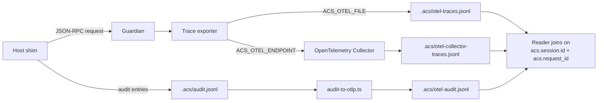
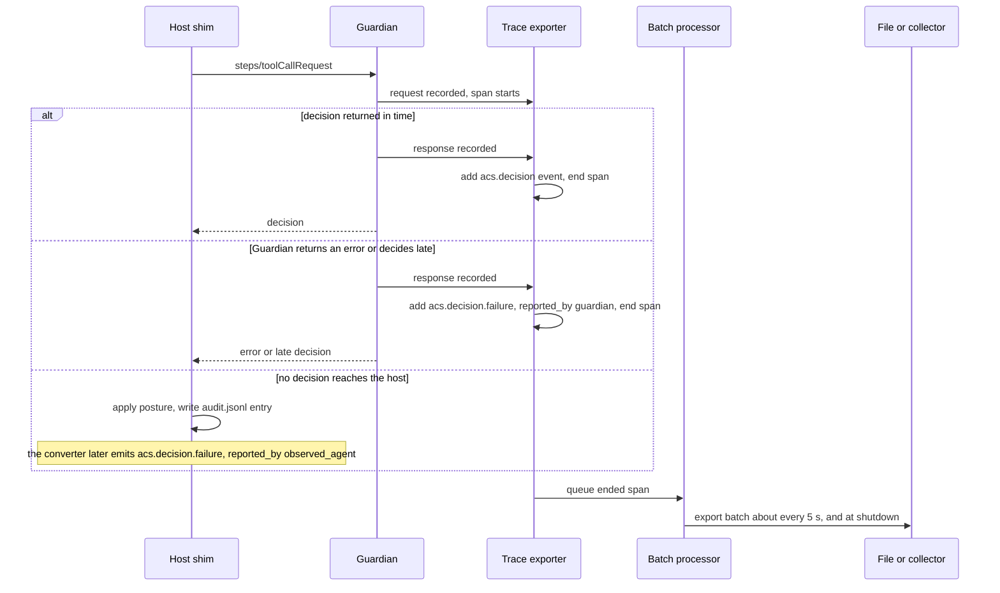

# Extending OpenTelemetry

ACS reuses OpenTelemetry as the primary observability transport. Each ACS step becomes a span; each Guardian decision becomes a span event on the parent step span. The result is an end-to-end view of agent behavior — reasoning, retrieval, tool calls, decisions — already shaped to fit existing OTel-based tooling.

The normative span-name and required-attribute table is on the [Trace Events](./events.md) page. The machine-readable mapping lives at [`trace/otel-mapping.json`](https://genai-security-project.github.io/agent-control-standard/schema/v0.1.0/trace/otel-mapping.json). This page describes how to *use* the mapping in practice.

## Span hierarchy

A typical agent session produces a tree of spans:

- A root **session** span (`acs.session`) opened by `steps/sessionStart` and closed by `steps/sessionEnd`. Carries `acs.session.id` and (when set) `acs.tenant_id`.
- One **turn** span (`acs.turn`) per agent turn, opened by `steps/turnStart` and closed by `steps/turnEnd`. Carries `acs.turn.id`. Nested turns (e.g. subagent turns inside a parent turn awaiting `subagentStop`) record `acs.turn.parent_id`.
- One **step** span per `steps/*` hook, parented to the enclosing turn (or session when the step is session-level: `agentTrigger`, `agbom/*` outside a turn). Every step span carries `acs.request_id` and `acs.session.id`, the pair a reader joins on.
- Each **decision** is a span event on the step span carrying `acs.decision`, plus `acs.evaluator` (`deterministic` / `agent` / `composite`), `acs.reasoning`, and `acs.confidence` when the response carries them. The replay attributes on [Trace Events](./events.md) ride the same event. Decisions are not separate spans because the verdict and the action it gates share a parent.
- A **decision failure** is a separate span event, `acs.decision.failure`, on the same step span. It records that no usable decision arrived and the deployment's failure posture.

This hierarchy is deterministic — implementations that follow the mapping produce comparable traces across vendors and Guardians.

## Example: a denied tool call

This is one span the reference Guardian exported, a `steps/toolCallRequest` the stock policy denied, copied from the committed [sample trace](https://github.com/GenAI-Security-Project/agent-control-standard/blob/main/reference-implementations/agt/samples/trace/acs-trace-sample.jsonl). Every value in it is synthetic. It's the OTLP/JSON shape the exporter writes, so attribute values are typed (`stringValue`, `arrayValue`).

The span carries the join pair (`acs.session.id` and `acs.request_id`), the tool name, and the two Provenance columns. `acs.provenance.source_id` has `""` where the second object has no `source_id`. The decision rides on the span as the `acs.decision` event, with the verdict, the reasoning, the reason codes and the three policy arrays. `acs.policy.versions` is `[""]`, because this Guardian doesn't send a policy version.

```json
{
  "traceId": "13717f291e2368066d2fa3f2434ed2f6",
  "spanId": "2a7efedbb7ee3881",
  "name": "gen_ai.tool.call",
  "kind": 1,
  "startTimeUnixNano": "1792534253716796645",
  "endTimeUnixNano": "1792534253780000000",
  "attributes": [
    {
      "key": "acs.session.id",
      "value": {
        "stringValue": "5a3c1e7e-0b1d-4c6a-9e2f-7d4b8c0a1f01"
      }
    },
    {
      "key": "acs.request_id",
      "value": {
        "stringValue": "1b6f0c2a-3d4e-4f5a-8b6c-7d8e9f0a1b03"
      }
    },
    {
      "key": "gen_ai.tool.name",
      "value": {
        "stringValue": "Bash"
      }
    },
    {
      "key": "acs.provenance.origin",
      "value": {
        "arrayValue": {
          "values": [
            {
              "stringValue": "user_input"
            },
            {
              "stringValue": "agent_generated"
            }
          ]
        }
      }
    },
    {
      "key": "acs.provenance.source_id",
      "value": {
        "arrayValue": {
          "values": [
            {
              "stringValue": "sample-user-1"
            },
            {
              "stringValue": ""
            }
          ]
        }
      }
    }
  ],
  "droppedAttributesCount": 0,
  "events": [
    {
      "attributes": [
        {
          "key": "acs.decision",
          "value": {
            "stringValue": "deny"
          }
        },
        {
          "key": "acs.reasoning",
          "value": {
            "stringValue": "This command was blocked because it matches a destructive-shell-command pattern. Policy: destructive_shell_command_blocked, from AGT's stock bundle (agt_stock). Matched at offset 0."
          }
        },
        {
          "key": "acs.reason_codes",
          "value": {
            "arrayValue": {
              "values": [
                {
                  "stringValue": "destructive_shell_command_blocked"
                }
              ]
            }
          }
        },
        {
          "key": "acs.policy.ids",
          "value": {
            "arrayValue": {
              "values": [
                {
                  "stringValue": "agt_stock"
                }
              ]
            }
          }
        },
        {
          "key": "acs.policy.versions",
          "value": {
            "arrayValue": {
              "values": [
                {
                  "stringValue": ""
                }
              ]
            }
          }
        },
        {
          "key": "acs.policy.rule_ids",
          "value": {
            "arrayValue": {
              "values": [
                {
                  "stringValue": "destructive_shell_command_blocked"
                }
              ]
            }
          }
        }
      ],
      "name": "acs.decision",
      "timeUnixNano": "1792534253780000000",
      "droppedAttributesCount": 0
    }
  ],
  "droppedEventsCount": 0,
  "status": {
    "code": 0
  },
  "links": [],
  "droppedLinksCount": 0,
  "flags": 257
}
```

To produce a trace like this yourself, follow [Produce a trace](https://github.com/GenAI-Security-Project/agent-control-standard/blob/main/reference-implementations/agt/README.md#produce-a-trace) in the reference implementation's README.

## How the reference Guardian produces a trace

The span above is real output from the reference Guardian. This section explains the pipeline behind it, so the span hierarchy and the decision events on this page map onto processes and files you can inspect. The [reference Guardian](https://github.com/GenAI-Security-Project/agent-control-standard/blob/main/reference-implementations/agt/packages/guardian/README.md#export-traces) exports spans for the two hook methods it evaluates, `steps/toolCallRequest` and `steps/toolCallResult`. It makes no ACS-Trace conformance claim. The commands to run it live in [Produce a trace](https://github.com/GenAI-Security-Project/agent-control-standard/blob/main/reference-implementations/agt/README.md#produce-a-trace), and this section doesn't repeat them.

### Two streams, joined by a reader

No single process sees every outcome of a step. The Guardian sees each request it receives and the answer it gives. It exports one span per step it trusted, with the `acs.decision` event on it, and records a request it rejected before trusting it apart, under names other than `acs.session.id` and `acs.request_id`. It also reports the failures it can see itself: an error it returned instead of a decision because it could not handle the step, a decision it finished after the negotiated timeout, and a step still open when it shut down.

The host sees what the Guardian can't. An unreachable Guardian has nothing to record. A Guardian whose answer arrives after the host stopped waiting can't see what the host did in the meantime. The host adapter records both cases in its own audit log. A converter, `audit-to-otlp.ts`, turns that log into spans of the same OTLP/JSON shape, each with an `acs.decision.failure` event whose `acs.failure.reported_by` is `observed_agent`.

A reader joins the two streams on `acs.session.id` plus `acs.request_id`, the pair every step span carries. The reference exporter makes each step span a root span, with no `acs.session` or `acs.turn` parent, so the join runs on those attributes, not on `traceId`.

In the diagram, look for the two separate paths out of the host shim. They meet only at the reader.



### Follow one tool call

The span's lifetime follows the Guardian's envelope log. It opens when the Guardian records the request and ends when the Guardian records its response, before the response goes out. Export happens later, on a timer, so serializing and writing spans stay off the decision path.

The sequence below follows one `steps/toolCallRequest`. Watch the `alt` block: the top branch is the working path, and the two lower branches show who reports the failure when no usable decision arrives.



A late decision gets both events on one span: the `acs.decision` with the verdict, then an `acs.decision.failure` with class `timeout`. When either party's stream holds a failure event for a pair, a reader doesn't count that pair's `acs.decision` as enforced. [Trace Events](./events.md) states that rule.

The Guardian never copies its error text into the trace. A failure event carries the error code, the timeout, the elapsed time and the request size when they're known, because error text can quote the request. A request the Guardian rejected before trusting it, by a failed validation, signature, replay or timestamp check, gets no event under the pair it carried, since that pair can be a genuine request's. The reference Guardian records it as a separate span under its own names instead.

If you only need to read a trace, you can stop here. The rest of this section is for running the pipeline or building your own.

### What each output is for

`.acs/otel-traces.jsonl` is the Guardian's own file, written when `ACS_OTEL_FILE` is set. It holds one OTLP `ExportTraceServiceRequest` per line, the shape the OpenTelemetry Collector's file exporter writes. It's the file to read offline or hand to a reviewer.

The collector path, set with `ACS_OTEL_ENDPOINT`, sends the same spans over OTLP/HTTP. The committed [`otel-collector.yaml`](https://github.com/GenAI-Security-Project/agent-control-standard/blob/main/reference-implementations/agt/otel-collector.yaml) writes them to `.acs/otel-collector-traces.jsonl`. Use it as an independent check that the output is valid OTLP, and as the starting point for sending spans to a real backend.

`.acs/otel-audit.jsonl` comes from the converter, not the Guardian. It holds only the host-side failures, and it matters most when the Guardian was down. The converter runs after the session ends and refuses to write to a file that already exists. Its spans carry `service.name` `acs-reference-audit-converter`, where the Guardian's carry `acs-reference-guardian`.

The two Guardian outputs fail independently. The first failed write or send disables that output for the rest of the process and prints one line on stderr. The other output keeps running, and the decision goes out unchanged, as the [failure isolation](#failure-isolation) rule below requires. The [Guardian README](https://github.com/GenAI-Security-Project/agent-control-standard/blob/main/reference-implementations/agt/packages/guardian/README.md#troubleshooting) lists the messages you may see.

The committed [sample trace](https://github.com/GenAI-Security-Project/agent-control-standard/blob/main/reference-implementations/agt/samples/trace/acs-trace-sample.jsonl) holds both streams in one file: five spans from the Guardian, one of them a rejected request, and one from the converter. Every value in it is synthetic.

### What the labels don't prove

`service.name` tells you which writer claims a span. It isn't authentication. Any process running as the same user, the observed agent included, can write the trace files, the audit log, or the collector's loopback port. In a container, other containers on the same network can reach that port too. A loopback address isn't authentication either.

`acs.failure.reported_by` is the emitter's own claim too. The trace is a record of what each party says happened, not tamper-evident evidence. Treat every value in it as untrusted data, as [Trace Events](./events.md) requires.

## Provenance attributes

When a hook payload carries Provenance, the resulting span MUST carry `acs.provenance.origin` and SHOULD carry `acs.provenance.source_id` when populated. The set of provenance ids cited by a Guardian decision (the response envelope's `cited_provenance_ids`) MAY be expressed as OTel span links keyed by `provenance_id`, letting tools that index span links reconstruct the lineage graph without parsing payloads.

v0.1 emits factual provenance attributes only. Trust classification is computed by the Guardian against local policy and is not a v0.1 span attribute.

## Sensitive data

Attributes can carry user prompts, tool arguments, and retrieved knowledge. Any of it can carry text an attacker influenced. [Trace Events](./events.md) says how consumers treat it. Implementations SHOULD apply the deployment's redaction or hashing policy at attribute-emit time rather than relying on backend-side scrubbing. The Guardian's `modifications.redactions` payload is the natural input to the policy: the same list that drives content rewriting drives attribute redaction.

## Transport

ACS does not redefine a trace transport. Implementations emit OTLP/gRPC or OTLP/HTTP to existing backends. The Guardian's handshake `trace_emission` field MAY advertise an OTLP collector endpoint; when set, the Observed Agent SHOULD route ACS-shaped trace traffic there in addition to (or instead of) its default collector.

## Failure isolation

Trace events MUST NOT block enforcement. If the Trace sink is unreachable or returns an error, the Guardian's disposition MUST still be returned to the Observed Agent. The agent's hot path is enforcement; observability is best-effort.
