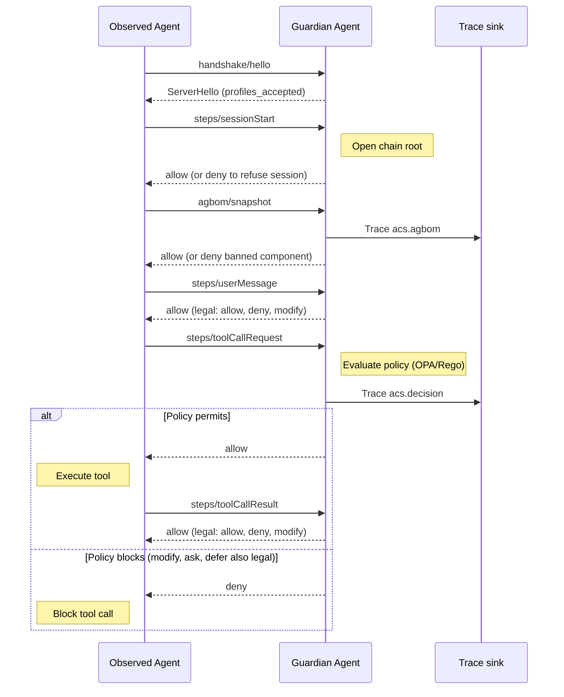

# ACS in Action

A worked example of an Observed Agent calling the `email.send` tool while a Guardian Agent enforces an ordinary OPA/Rego identity, role, and resource policy, emits a Trace event, and records the AgBOM. Later on this page, optional excerpts show how the same wire format supports research paradigms (IBAC, FIDES, CaMeL, AARM) without changing the envelope. Read [Core Concepts](./core_concepts.md) and [Authorization Paradigms](./authorization-paradigms.md) first if you want the background.

## Sequence

The diagram below shows a full session exchange: handshake, session start, AgBOM snapshot, user message, and a `steps/toolCallRequest` gate with both an `allow` path and a `deny` path. `agbom/snapshot` fires **after** `steps/sessionStart` and before any content-bearing hook ([Hooks](../spec/instrument/hooks.md#agbomsnapshot), [Inspect](../spec/inspect/README.md#wire-methods)). Under `acs-core`, every hook request and decision response carries `signature`, and every content-bearing response carries the updated `chain_hash`.



`deny` is legal at every decision-eligible hook shown:

| Hook | Legal dispositions | When a Guardian uses non-`allow` |
|---|---|---|
| `steps/sessionStart` | `allow`, `deny` | Refuse a session whose identity, platform, or declared policy mode fails checks |
| `agbom/snapshot` | `allow`, `deny` | Refuse a session whose component graph includes a banned model, tool, or peer |
| `steps/userMessage` | `allow`, `deny`, `modify` | Block disallowed input or redact sensitive content before it enters reasoning |
| `steps/toolCallRequest` | `allow`, `deny`, `modify`, `ask`, `defer` | Block, rewrite arguments, pause for approval, or defer execution |
| `steps/toolCallResult` | `allow`, `deny`, `modify` | Block or redact tool output before returning it to the LLM |

## The decision point: `steps/toolCallRequest`

The Observed Agent has been asked by an authenticated employee (`user-12345`, role `employee`) to "summarize Project X status and email it to my manager." The agent retrieved the status from a knowledge base (provenance `p2`), drafted the email body (`p3`, derived from `p2`), and is about to call `email.send`.

This example claims `acs-core`, `acs-trace`, `acs-inspect`, and `acs-provenance`. Following v0.1 expected practice ([§7.1](../spec/instrument/specification.md#71-optional-trust-enum)), the Provenance objects carry **factual provenance only** (`provenance_id`, `origin`, `source_id`, `derived_from`) and omit the optional `trust` enum. Any Guardian policy that needs trust derives it from `origin` and `source_id` against local policy, as [Trust basis](../concepts/trust.md) explains.

The `signature.value` strings and `chain_hash` digests below are illustrative placeholders computed over the canonical envelopes per [§8.2](../spec/instrument/specification.md#82-chain-hashing-normative) and [§10](../spec/instrument/specification.md#10-cryptographic-signatures).

### Request

```json
{
  "jsonrpc": "2.0",
  "method": "steps/toolCallRequest",
  "id": "req-001",
  "params": {
    "acs_version": "0.1.0",
    "request_id": "550e8400-e29b-41d4-a716-446655440000",
    "timestamp": "2026-04-30T10:30:00Z",
    "tenant_id": "acme-corp",
    "metadata": {
      "agent_id": "cursor-agent-01",
      "session_id": "7c9e6679-7425-40de-944b-e07fc1f90ae7",
      "turn_id": "t-7",
      "platform": "cursor",
      "user_context": {
        "user_id": "user-12345",
        "roles": ["employee"],
        "authentication_method": "oidc"
      }
    },
    "payload": {
      "tool": { "name": "email.send" },
      "capability": "network.egress",
      "arguments": {
        "recipient": {
          "value": "manager@example.com",
          "provenance": {
            "provenance_id": "p1",
            "origin": "user_input",
            "source_id": "user-12345",
            "derived_from": []
          }
        },
        "body": {
          "value": "Project X summary: ...",
          "provenance": {
            "provenance_id": "p3",
            "origin": "agent_generated",
            "source_id": "llm-gpt-4",
            "derived_from": ["p2"]
          }
        }
      }
    },
    "signature": {
      "algorithm": "HMAC-SHA256",
      "value": "<base64 HMAC-SHA256 over UTF-8 JCS(envelope without params.signature)>",
      "key_id": "acs-hmac-key-1"
    }
  }
}
```

### Plain OPA/Rego policy (identity, role, and resource)

[Specification §12.1](../spec/instrument/specification.md#121-policy-engine-interface) names OPA/Rego as the v0.1 starting reference engine. A straightforward deployment checks who is acting, what role they hold, and which resource the tool targets — no specialized research paradigm required:

```rego
package acs.email

import rego.v1

default allow := false

allow if {
  input.params.payload.tool.name == "email.send"
  "employee" in input.params.metadata.user_context.roles
  endswith(input.params.payload.arguments.recipient.value, "@example.com")
}
```

### Decision: `allow` (internal recipient)

The caller holds role `employee` and the recipient is in `@example.com`, so the deterministic layer allows the call. Notice that `reasoning` is omitted here: per [§6.1](../spec/instrument/specification.md#61-decision-result-fields), `reasoning` is optional on `allow` and required on `deny`, `modify`, `ask`, and `defer`.

```json
{
  "jsonrpc": "2.0",
  "id": "req-001",
  "result": {
    "type": "final",
    "acs_version": "0.1.0",
    "request_id": "550e8400-e29b-41d4-a716-446655440000",
    "decision": "allow",
    "reason_codes": ["internal_recipient_allowed"],
    "policy_references": [
      {
        "policy_id": "acme-email-baseline",
        "policy_version": "v1",
        "rule_id": "allow-employee-internal-email"
      }
    ],
    "chain_hash": "8f3c2d9a1b4e7065c8d1f2a3b4c5d6e7f8091a2b3c4d5e6f708192a3b4c5d6e7",
    "metadata": {
      "evaluator": "deterministic",
      "evaluator_version": "opa-1.0",
      "evaluation_duration_ms": 4
    },
    "signature": {
      "algorithm": "HMAC-SHA256",
      "value": "<base64 HMAC-SHA256 over UTF-8 JCS(envelope without result.signature)>",
      "key_id": "acs-hmac-key-1"
    }
  }
}
```

### Decision: `deny` (external recipient)

If the same agent instead tries to call `email.send` with `"recipient": { "value": "external@example.org", ... }` on request `req-002`, the same OPA/Rego rule blocks it. `reasoning` gives one short sentence for a human reader, while machine-readable fields (`reason_codes`, `policy_references`, `policy_data`) carry the structured facts:

```json
{
  "jsonrpc": "2.0",
  "id": "req-002",
  "result": {
    "type": "final",
    "acs_version": "0.1.0",
    "request_id": "661f9511-f3ac-52e5-b827-557766551111",
    "decision": "deny",
    "reasoning": "External email recipients are not allowed for this role.",
    "reason_codes": ["external_recipient_denied"],
    "policy_references": [
      {
        "policy_id": "acme-email-baseline",
        "policy_version": "v1",
        "rule_id": "internal-recipients-only"
      }
    ],
    "policy_data": {
      "recipient_domain": "example.org",
      "allowed_domains": ["example.com"],
      "caller_roles": ["employee"]
    },
    "chain_hash": "3a7e9b2c4d6f80123456789abcdef0123456789abcdef0123456789abcdef012",
    "metadata": {
      "evaluator": "deterministic",
      "evaluator_version": "opa-1.0",
      "evaluation_duration_ms": 3
    },
    "signature": {
      "algorithm": "HMAC-SHA256",
      "value": "<base64 HMAC-SHA256 over UTF-8 JCS(envelope without result.signature)>",
      "key_id": "acs-hmac-key-1"
    }
  }
}
```

## What the Guardian also does

The decision above is one of three concurrent obligations:

1. **Permit/deny/modify** — return the signed decision envelope with the updated `chain_hash` to the Observed Agent.
2. **Trace** — emit an OTel span event `acs.decision` on the parent `gen_ai.tool.call` span, plus an OCSF Detection Finding (2004) when the decision is non-`allow`. See [Trace Events](../spec/trace/events.md).
3. **AgBOM** — `agbom/snapshot` was emitted right after `steps/sessionStart`. If the deployment also claims `acs-inspect-dynamic` and the agent registers or swaps components later in the session, `agbom/changed` fires before any content-bearing hook continues. See [Inspect](../spec/inspect/README.md).

## What different paradigms cite (optional styles)

The ACS wire is **paradigm-neutral**. A Guardian is **not** required to implement IBAC, FIDES, CaMeL, or AARM. The handshake negotiates [conformance profiles](../spec/conformance.md) (`acs-core`, `acs-provenance`, `acs-audit`, and so on) rather than paradigm names, and no wire field declares which paradigm a Guardian runs.

The four architectures below are **optional policy and citation styles** that ride on the existing decision fields (`policy_references`, `reason_codes`, `policy_data`, `cited_provenance_ids`). See [Authorization Paradigms](./authorization-paradigms.md) for definitions, policy engines (OPA and Cedar), and how complete each v0.1 mapping is.

> **Excerpt note.** Each block below shows only the decision-specific fields inside `result`. On the wire, a conformant `acs-core` response wraps these fields in the full JSON-RPC envelope with `type: "final"`, `acs_version`, `request_id`, `chain_hash`, `signature`, and optional `metadata`, exactly as in the full responses above.

### IBAC — Intent-based authorization

**Source:** [ibac.dev](https://ibac.dev/) (Potti, 2026). **Mapping:** wire primitives (`Intent`, immutability in §8.4, `ASK` extension in §9.1) are complete for runtime gating; intent parsing and capability matching stay Guardian-internal. Requires `acs-core` only.

User's committed Intent: `["summarize.read"]`. The agent attempts `email.send` outside that capability list. An IBAC-style policy denies; the user can extend `Intent.parsed` via the [ASK flow](../spec/instrument/specification.md#91-intent-extension-via-ask-normative) if deployment policy permits.

```json
{
  "decision": "deny",
  "reasoning": "Sending email is outside the task authorized for this session.",
  "reason_codes": ["ibac_capability_mismatch"],
  "policy_references": [
    { "policy_id": "acme-ibac", "policy_version": "v1", "rule_id": "tool-call-must-be-in-intent" }
  ],
  "policy_data": {
    "ibac": {
      "requested_capability": { "tool": "email.send", "resource": "manager@example.com" },
      "intent_parsed": ["summarize.read"],
      "closest_match_in_intent": null
    }
  },
  "cited_provenance_ids": ["p1"]
}
```

### FIDES — Information flow control

**Source:** Costa et al., *Securing AI Agents with Information-Flow Control* ([arXiv:2505.23643](https://arxiv.org/abs/2505.23643), 2025). **Mapping:** partial (wire-data level) — ACS carries factual `Provenance` under `acs-provenance`; label lattice arithmetic and planner hiding/revealing primitives stay in the Guardian and framework.

Later in the session, `email.send` is called with both `recipient` and `body` derived from untrusted retrieved content (`p2`) with no trusted re-grounding, failing a FIDES-style planner-taint (`P-T`) check.

```json
{
  "decision": "deny",
  "reasoning": "Cannot send email when both recipient and body come from untrusted retrieved content.",
  "reason_codes": ["fides_p_t_failed", "untrusted_recipient_derivation"],
  "policy_references": [
    { "policy_id": "acme-fides", "policy_version": "v1", "rule_id": "no-untrusted-recipient-derivation" }
  ],
  "policy_data": {
    "fides": {
      "p_t_passed": false,
      "violating_argument_path": ["recipient"],
      "lineage_origins": ["retrieved", "agent_generated"],
      "earliest_untrusted_provenance_id": "p2"
    }
  },
  "cited_provenance_ids": ["p2", "p4", "p5"]
}
```

### CaMeL — Program synthesis

**Source:** Debenedetti et al., *Defeating Prompt Injections by Design* ([arXiv:2503.18813](https://arxiv.org/abs/2503.18813), 2025). **Mapping:** partial (enforcement-boundary level) — ACS carries per-argument `derived_from` lineage under `acs-provenance` and gates tool calls; CaMeL's dual-LLM split and interpreter live inside the Observed Agent framework.

A calendar agent's unprivileged model populates `attendees` from a forwarded invite (`origin: retrieved`) rather than the user's stated team list. A CaMeL-style policy denies because the argument's dependency graph violates the synthesized program's capability rules.

```json
{
  "decision": "deny",
  "reasoning": "Meeting attendees cannot come from untrusted retrieved content.",
  "reason_codes": ["camel_argument_dependency_violation"],
  "policy_references": [
    { "policy_id": "acme-camel", "policy_version": "v1", "rule_id": "consequential-args-must-trace-to-trusted-input" }
  ],
  "policy_data": {
    "camel": {
      "argument_path": ["attendees"],
      "argument_lineage": ["p7", "p6"],
      "expected_lineage_root": { "origin": "user_input", "provenance_id": "p1" },
      "actual_lineage_root": { "origin": "retrieved", "source_id": "calendar-invite-2026-04-29" }
    }
  },
  "cited_provenance_ids": ["p1", "p6", "p7"]
}
```

### AARM — Cumulative-context tracking

**Source:** *Autonomous Action Runtime Management (AARM)* ([arXiv:2602.09433](https://arxiv.org/abs/2602.09433), [aarm.dev](https://aarm.dev/)). **Mapping:** high-level alignment across `acs-core`, `acs-audit`, `acs-crypto`, and `acs-provenance`; the full R1–R9 gap analysis is tracked separately in [issue #213](https://github.com/GenAI-Security-Project/agent-control-standard/issues/213).

After a session processes untrusted email content, the agent attempts `payment.transfer`. Even if the transfer arguments look clean, lookback over the session's `provenance_summary` shows untrusted retrieval without trusted re-grounding, so deployment policy denies consequential financial actions in the tainted window.

```json
{
  "decision": "deny",
  "reasoning": "Financial transfers are blocked after untrusted content has entered the session.",
  "reason_codes": ["aarm_cumulative_taint", "consequential_action_in_tainted_window"],
  "policy_references": [
    { "policy_id": "acme-aarm", "policy_version": "v1", "rule_id": "no-consequential-finance-after-untrusted-retrieval" }
  ],
  "policy_data": {
    "aarm": {
      "lookback_window": "session",
      "earliest_untrusted_step_id": "s-14",
      "untrusted_origins_seen": ["retrieved", "tool_output"],
      "entry_count_by_origin": { "user_input": 4, "retrieved": 2, "tool_output": 11, "agent_generated": 9 },
      "trusted_regrounding_since": null
    }
  },
  "cited_provenance_ids": ["p_s14", "p_s17", "p_s23"]
}
```

### Composition: IBAC outer + FIDES inner

In multi-paradigm deployments a single decision can cite all firing rules — `policy_references` carries one entry per rule, `reason_codes` aggregates, and `policy_data` is keyed by paradigm name:

```json
{
  "decision": "deny",
  "reasoning": "Sending email is outside the authorized task and uses untrusted retrieved content.",
  "reason_codes": ["ibac_capability_mismatch", "fides_p_t_failed"],
  "policy_references": [
    { "policy_id": "acme-ibac", "policy_version": "v1", "rule_id": "tool-call-must-be-in-intent" },
    { "policy_id": "acme-fides", "policy_version": "v1", "rule_id": "p-t-blocks-untrusted-derivation" }
  ],
  "policy_data": {
    "ibac": { "requested_capability": { "tool": "email.send" }, "intent_parsed": ["summarize.read"] },
    "fides": { "p_t_passed": false, "violating_argument_path": ["body"] }
  },
  "cited_provenance_ids": ["p1", "p2", "p3"]
}
```

Audit replay walks `policy_references` to reconstruct each rule's contribution independently.

## Read Next

- [Run a Guardian](./reference-implementations.md)
- [Authorization Paradigms](./authorization-paradigms.md)
- [Instrument](../spec/instrument/README.md)
- [Trace](../spec/trace/README.md)
- [Inspect](../spec/inspect/README.md)
- [Conformance Profiles](../spec/conformance.md)
