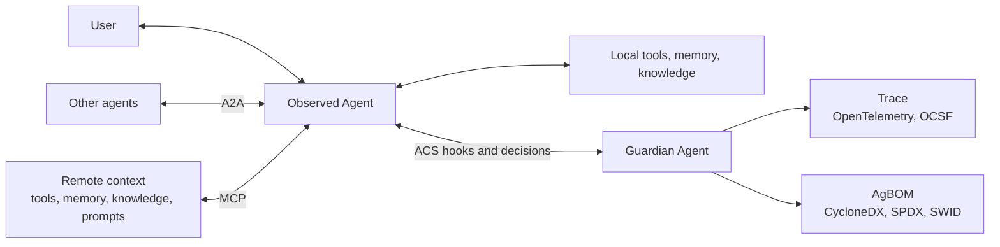

# Core Concepts

ACS specifies how an AI agent exposes its behavior so a separate **Guardian Agent** can permit, deny, or modify what the agent does, in real time, with an observable, reconstructable audit trail. The agent being monitored is an **Observed Agent**.

## The three pillars

ACS v0.1.0 organizes capabilities into three co-equal pillars:

1. **Instrument**: real-time control points (hooks). Observed Agents send hook traffic to the Guardian; the Guardian returns one of five dispositions (`allow`, `deny`, `modify`, `ask`, `defer`; `modify` is SHOULD-support — a Guardian substitutes `deny` for clients that cannot apply it, or `allow` with an audit event at `postCompact`, [§6.5](../spec/instrument/specification.md#65-modify-incapable-clients-normative)). Hooks fire before actions execute, enabling preventive enforcement. See [Specification](../spec/instrument/specification.md) and [Hooks](../spec/instrument/hooks.md).
2. **Trace**: deterministic event emission. Every hook is also recordable as an OpenTelemetry span and an OCSF event. Decisions are recorded as span events on the parent step span, so the verdict and the action it gates share a parent. See [Trace Events](../spec/trace/events.md).
3. **Inspect**: queryable, dynamic Agent Bill of Materials (AgBOM). The Observed Agent declares its components (models, MCP servers, A2A peers, tools, knowledge sources, memory stores) and reports mutations. See [Inspect](../spec/inspect/README.md).

A v0.1.0-conformant deployment implements **ACS-Core** (the Instrument baseline). Trace, Inspect, field-level Provenance, cryptographic signatures, and strengthened audit chains are organized as [conformance profiles](../spec/conformance.md) declared in the handshake.

## The two parties

- **Observed Agent**: the LLM-backed system being monitored. Sends hook traffic. Enforces decisions.
- **Guardian Agent**: the policy enforcement point. Two internal layers:
    - **Deterministic layer** (OPA/Rego, Cedar): always runs first.
    - **Agent layer** (LLM): invoked only when the deterministic layer's chain config delegates. Optional in v0.1.0. Deterministic-only deployments are fully conformant.

## Identity

Identity answers who is acting. A **principal** is the authenticated party initiating or acting within a session. ACS keeps three identities distinct: which agent is under governance, which Guardian decided, and who authored the policy that produced the decision. Conflating them collapses an audit trail into "the agent did it."

ACS invents no identity format. Descriptors carry a `type` discriminator naming the scheme (`posix_uid`, `oauth_subject`, `cert_subject`), and ACS stays agnostic to the rest. No authentication mechanism is mandated. Deployments declare the one they use at handshake, which binds ACS to the identity infrastructure an organization already runs.

Identity is an upstream dependency of authorization: a capability decision is only as meaningful as the identity bound to it. An asserted identity is weaker than one bound by a verified credential, so policy gating high-impact actions should require the stronger rung. See [Concepts › Identity](../concepts/identity.md) and [Concepts › Trust basis](../concepts/trust.md).

Runtime identity for agents raises problems that human and workload identity models do not answer, from delegation chains spanning five to ten hops to intent that must survive mid-task reframing. The Identity workstream tracks those as open work. See [Identity › Overview](../identity/overview.md) for the five runtime challenges and [Identity › Standards](../identity/standards.md) for where existing standards stop short.

## Vocabulary

ACS scopes what it observes to a **session**, and within it to **turns** and **steps**. Each step produces a `ContextEntry` in the session's append-only audit chain, and the Guardian's verdict on it is one of five **dispositions** (`allow`, `deny`, `modify`, `ask`, `defer`).

Canonical definitions live in [Concepts › Session lifecycle](../concepts/session-lifecycle.md); the verdict set is specified in [Disposition Vocabulary](../spec/instrument/specification.md#6-disposition-vocabulary).

## Provenance

Every data-bearing field may carry a **Provenance** object (`provenance_id`, `origin`, `source_id`, `derived_from` (lineage)) populated by deterministic framework code at channel boundaries, never by the LLM. v0.1.0 keeps trust *classification* off the mandatory wire surface: Guardians derive it from `origin` + `source_id` against local policy.

Field-level Provenance is required under the **ACS-Provenance** profile and load-bearing for FIDES, CaMeL, and AARM-style enforcement. See [Concepts › Provenance](../concepts/provenance.md) and [§7](../spec/instrument/specification.md#7-provenance).

## SessionContext and Intent

The Guardian maintains per-session state: the audit chain, the running provenance summary, and (optionally) an **Intent**, the structured authorization for the session (`raw`, `parsed`, `parser_provenance`, `scope_mode`). The Observed Agent sends only the `session_id` and an optional `chain_hash` for verification; SessionContext lives only on the Guardian.

Once an Intent is established, `Intent.parsed` is immutable to the runtime LLM and to untrusted data, and grows only through approver action via the ASK flow, the rule that makes IBAC's central security claim hold. See [Concepts › Intent](../concepts/intent.md) and [§8](../spec/instrument/specification.md#8-sessioncontext-and-intent).

## Agent environment

| Component | Description | Local | Remote | Protocol |
|---|---|---|---|---|
| User | Direct or indirect human interface | ✓ | ✓ | n/a |
| Trigger | System event activating the agent (notifications, schedules, A2A inbound) | ✓ | ✓ | n/a |
| Other Agents | Peer agents | ✓ | ✓ | A2A |
| Memory | Short- or long-term state | ✓ | ✓ | n/a |
| Knowledge | Files, RAG sources, vector DBs | ✓ | ✓ | MCP |
| Prompts | Saved templates for sub-tasks | ✓ | ✗ | MCP |
| API Tools | REST or function calls | ✓ | ✓ | MCP |
| OS Tools | OS calls or keyboard/mouse manipulation (CUA agents) | ✓ | ✗ | n/a |
| LLM | Reasoning / sub-task model | ✓ | ✓ | n/a |

## A2A and MCP

Specification v0.1.0 defines MCP wrapping through `protocols/MCP/*`, for example `protocols/MCP/tools/call`, and plans the same for A2A. ACS also proposes security extensions for [MCP](../spec/instrument/extend_mcp.md) and [A2A](../spec/instrument/a2a/extend_a2a.md) for native observability support. The `protocols/A2A/*` namespace is reserved in v0.1.0, and the wrapping specification is planned for v0.2.0. The reference adapters in release 0.1.5 send MCP tool calls through the generic tool hooks and wrap no other MCP traffic, as the [adapters README](https://github.com/GenAI-Security-Project/agent-control-standard/blob/main/adapters/README.md#the-acs-v010-emission-conformance-check) explains.

## Read Next

- [Concepts](../concepts/README.md)
- [Identity for Agents](../identity/overview.md)
- [Authorization Paradigms](./authorization-paradigms.md)
- [ACS in Action](./ACS_in_action_example.md)
- [Conformance Profiles](../spec/conformance.md)
- [Specification](../spec/instrument/specification.md)
