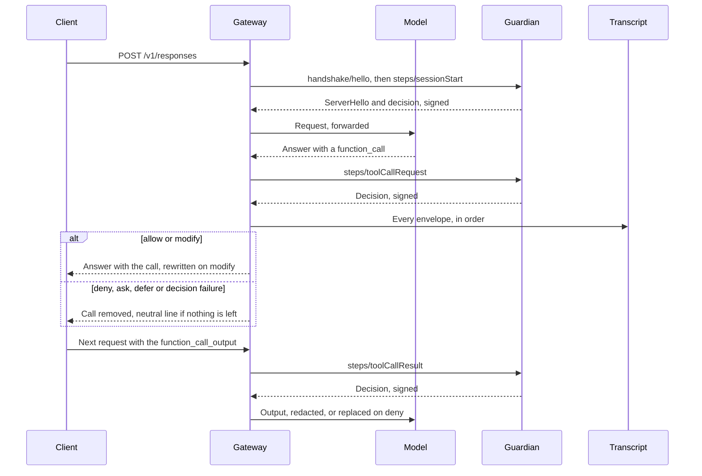

# Govern an Unmodified Agent

Some agents you cannot change: a vendor's product, a team's service, a demo you only run. If the agent speaks the OpenAI Responses API, you can still govern it. Point its `OPENAI_BASE_URL` at the ACS gateway, run the gateway in shadow or enforce mode, and change nothing else in the agent. Every tool call the model proposes then reaches a Guardian before the agent sees it. The address alone is not enough: the gateway's mode defaults to off, and off governs nothing.

The gateway ships in release 0.1.5 as `acs-gateway`, a reference implementation built for the project's December 9, 2026 guided lab. Its [README](https://github.com/GenAI-Security-Project/agent-control-standard/blob/main/adapters/gateway/README.md) owns every setting, mode and record format. This page explains what the gateway does and where it stops.

## Know what the gateway can see

The gateway sits at the model boundary. It forwards each `POST /v1/responses` to the model and acts as the client's **Observed Agent**, the party that asks a Guardian before a step runs. It governs two hooks:

- Each new `function_call` in a model answer goes to the Guardian as `steps/toolCallRequest` before the client sees it.
- Each new `function_call_output` in a client request goes to the Guardian as `steps/toolCallResult` before the model sees it.

That boundary is the point and the limit. A proxy sees only what crosses the wire between the client and its model, so it can gate the calls a model asks for and the results that flow back. It cannot see the client's memory, its subagents, or anything the client does without asking the model. Governing those needs an adapter inside the agent, as [Run a Guardian](./reference-implementations.md#connect-your-agent) describes.

The diagram below opens with the **handshake**. The gateway sends `handshake/hello`, its ClientHello, to say which ACS versions and signatures it supports. The Guardian's **ServerHello** answers with what the session will use. `steps/sessionStart` then opens the session, and each tool call after it is one step.

When the gateway removes a call and nothing else is left, it sends one assistant message, `I couldn't complete that action.` That neutral line is the only sign of governance the client or the model ever sees.

## Pick a mode

`ACS_LAB_MODE` chooses one of three modes, and unset means off, so nothing is governed or blocked by accident.

**Off** forwards every byte unchanged and talks to no Guardian. **Shadow** sends both hooks and records each decision but changes nothing, so you can see what enforce would have done to a real run. Shadow is not decision honoring under [§6.4](../spec/instrument/specification.md#64-honoring-decisions-normative). **Enforce** applies each decision. The [Modes table](https://github.com/GenAI-Security-Project/agent-control-standard/blob/main/adapters/gateway/README.md#modes) shows what reaches each side in each mode.

## Know what enforce refuses

Enforce accepts only what it can gate. Request fields, input items, content parts and tool types each have an allowlist, and anything outside one answers 501 and is audited. A new API feature therefore fails closed instead of slipping a tool call past the Guardian.

On a decision failure, a timeout, an error, an HTTP 429 or an answer that fails verification, enforce removes the call or replaces the output. The gateway's own configuration sets that posture, and a ServerHello that declares `proceed` cannot loosen it ([D-045](../decisions/index.md#d-045-only-the-observed-agents-own-configuration-can-opt-into-proceed)). [How enforce applies a decision](https://github.com/GenAI-Security-Project/agent-control-standard/blob/main/adapters/gateway/README.md#how-enforce-applies-a-decision) has the full table.

## Use the rest of what ships

The gateway does more than gate single answers. Its README section for each one has the settings. In shadow and enforce, streaming is governed whenever the client streams, and the tool digest is always sent but only matters when a policy pins it. Upstream mode defaults to live. The approver page and traces are off until you set them.

- [Streaming](https://github.com/GenAI-Security-Project/agent-control-standard/blob/main/adapters/gateway/README.md#streaming) works in shadow and enforce. Enforce streams message text as the model writes it and holds every call until the stream ends and the Guardian decides.
- [Upstream modes](https://github.com/GenAI-Security-Project/agent-control-standard/blob/main/adapters/gateway/README.md#upstream-modes) choose live, capture or replay. Replay answers from recorded exchanges with no network and no credentials, which makes a run repeatable.
- Tool digest pinning puts a SHA-256 of each tool's declaration in `tool.version`, so a policy can pin a tool and catch a changed description. The field's use is a lab convention.
- The [approver page](https://github.com/GenAI-Security-Project/agent-control-standard/blob/main/adapters/gateway/README.md#ask-and-the-approver-page) holds a call that gets `ask` until a person approves or rejects it, and the Guardian's next decision releases or blocks it. Without the page, every `ask` denies.
- [Traces](https://github.com/GenAI-Security-Project/agent-control-standard/blob/main/adapters/gateway/README.md#traces) export over OTLP HTTP when `OTEL_EXPORTER_OTLP_ENDPOINT` is set, with one span per session, model call and Guardian step.

## Keep the transcript

In shadow and enforce, the gateway writes every envelope it exchanges with the Guardian to one file per session, in send order. The file starts with the handshake and holds refusals and tampered answers verbatim, so a reviewer judges what the Guardian actually sent. [Records](https://github.com/GenAI-Security-Project/agent-control-standard/blob/main/adapters/gateway/README.md#records) describes the format, which is a lab convention.

That transcript is what `acs-verify` checks offline. [Sign and verify decisions](./signed-decisions.md) explains how.

## Run it

The gateway needs a Guardian that holds the same HMAC secret and the same `key_id`, the label that names which secret signed a message. The README's [Run it](https://github.com/GenAI-Security-Project/agent-control-standard/blob/main/adapters/gateway/README.md#run-it) section starts the example Guardian and the gateway in enforce mode with a handful of environment variables. Then point your client at the gateway's address.

## Read Next

- [Sign and verify decisions](./signed-decisions.md)
- [Run a Guardian](./reference-implementations.md)
- [Hooks › toolCallRequest](../spec/instrument/hooks.md#toolcallrequest)
