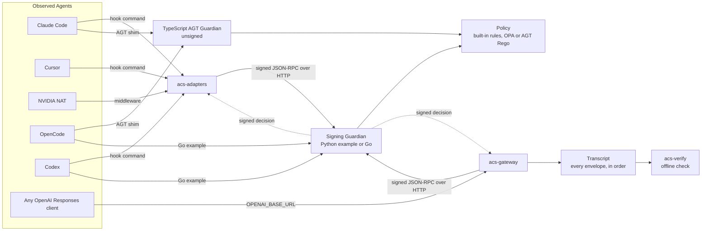

# Run a Guardian

ACS is a contract between an agent and a Guardian, and release 0.1.5 ships working code on both sides of it. You can start a Guardian on your laptop, connect Claude Code, Cursor, NVIDIA NAT, OpenCode, Codex or any OpenAI Responses client to it without changing the agent's code, and watch it deny a destructive command. This page maps what ships and helps you pick a starting point. Each component's README owns its commands and details.

Everything here is a reference implementation. It shows the contract working and gives you something to test against. None of it is a production Guardian, and several features are lab conventions, which [the last section](#know-what-a-lab-convention-is) explains.

## See the whole system

An **Observed Agent** is the agent under governance. Before it acts, it sends the proposed step to a **Guardian**, a separate service that evaluates policy and answers with one of five dispositions: `allow`, `deny`, `modify`, `ask` or `defer`. Release 0.1.5 implements specification v0.1.0, and every component below speaks that version of the wire.

Agents reach a Guardian in one of two ways. An **adapter** is a small program the agent's own hook configuration runs, so the agent asks at each hook it exposes. The **gateway** sits between an unmodified client and its model, so it sees the tool calls the model proposes and the results that go back. Both send JSON-RPC 2.0 over HTTP, and both sign every request with HMAC-SHA256. **ACS-Core** is the mandatory baseline of the specification, the part every conformant deployment implements, and HMAC-SHA256 is its baseline signature.

## Pick a Guardian

Three Guardians ship in 0.1.5. The adapters and the gateway refuse an unsigned answer, so they work with the two Guardians that sign: the Python example Guardian and the Go Guardian. The TypeScript AGT Guardian signs nothing, so it works with its own Claude Code and OpenCode shims instead. No Cursor shim ships for it.

The table's posture column needs two terms. When an agent connects, it opens with a **handshake**: its ClientHello says what it supports, and the Guardian's **ServerHello** answers with what the session will use. The ServerHello declares a **failure posture**, which says what the agent does when no usable decision arrives: `deny` blocks the step, and `proceed` lets it run. [Know what happens when the Guardian fails](#know-what-happens-when-the-guardian-fails) covers it in full.

| Guardian | Where it lives | Policy | Signing | Failure posture it declares | Start here |
|---|---|---|---|---|---|
| Python example Guardian | `adapters/`, command `acs-example-guardian` | A short built-in rule table, or an OPA server you run | Verifies and signs HMAC-SHA256. Opt-in ML-DSA-65 decision signing | `deny` | [Example Guardian README](https://github.com/GenAI-Security-Project/agent-control-standard/blob/main/adapters/docs/guardian/README.md) |
| TypeScript AGT Guardian | `reference-implementations/agt/`, command `bun run guardian` | Microsoft's Agent Governance Toolkit (AGT) stock Rego bundle | None yet, so the wire is unauthenticated | `proceed`, unless `ACS_ON_DECISION_FAILURE=deny` | [AGT reference implementation README](https://github.com/GenAI-Security-Project/agent-control-standard/blob/main/reference-implementations/agt/README.md) |
| Go Guardian | `reference-implementations/agt-go/`, command `make run` | The same AGT Rego policies through the AGT runtime. Also usable as a Go library | Verifies and signs HMAC-SHA256 | `deny`, set in `guardian.yaml` | [Go Guardian README](https://github.com/GenAI-Security-Project/agent-control-standard/blob/main/reference-implementations/agt-go/README.md) |

Start with the example Guardian if you want the shortest path from a fresh clone to a signed decision. It is a teaching artifact with a deliberately tiny policy, and its README's "What this is NOT" section says so plainly.

Pick the TypeScript AGT Guardian to see a real policy engine with the fewest prerequisites, through its own host shims. It needs only `bun`, and the [repository README](https://github.com/GenAI-Security-Project/agent-control-standard/blob/main/README.md#run-it-and-tell-us-where-it-breaks) walks through a first deny in a few minutes. It evaluates two hooks, `steps/toolCallRequest` and `steps/toolCallResult`, and its README lists every gap requirement by requirement.

Pick the Go Guardian when you want AGT policy with signed traffic. Its answers match the TypeScript Guardian's on 49 recorded sessions, and its [differences page](https://github.com/GenAI-Security-Project/agent-control-standard/blob/main/reference-implementations/agt-go/docs/differences.md) lists every deliberate difference. To connect the Claude Code, Cursor or NAT adapters to it, follow [Run with the reference adapters](https://github.com/GenAI-Security-Project/agent-control-standard/blob/main/reference-implementations/agt-go/docs/adapters.md), because the two sides read the shared secret file differently.

## Connect your agent

Each integration uses the agent's own extension point, so you change configuration, not agent code. Every one reaches the Guardian over HTTP. The specification also defines a stdio transport, but no shipped integration uses it.

| Agent | How it connects | What you install | Guide |
|---|---|---|---|
| Claude Code | A hook command in `settings.json`, run once per event | `acs-adapters`, or the AGT host shim for the TypeScript Guardian | [Claude Code adapter](https://github.com/GenAI-Security-Project/agent-control-standard/blob/main/adapters/docs/claude_code/README.md), [AGT shim](https://github.com/GenAI-Security-Project/agent-control-standard/blob/main/reference-implementations/agt/hosts/claude-code/README.md) |
| Cursor | A hook command in `hooks.json`, run once per event | `acs-adapters` | [Cursor adapter](https://github.com/GenAI-Security-Project/agent-control-standard/blob/main/adapters/docs/cursor/README.md) |
| NVIDIA NAT 1.7.0 | Middleware declared in `workflow.yml`, running inside the agent process | `acs-adapters` with its `nat` extra | [NAT adapter](https://github.com/GenAI-Security-Project/agent-control-standard/blob/main/adapters/docs/nat/README.md) |
| OpenCode | An in-process plugin | The AGT host shim, or the Go Guardian's example | [AGT shim](https://github.com/GenAI-Security-Project/agent-control-standard/blob/main/reference-implementations/agt/hosts/opencode/README.md), [Go example](https://github.com/GenAI-Security-Project/agent-control-standard/blob/main/reference-implementations/agt-go/examples/opencode/README.md) |
| Codex | A `PreToolUse` hook for shell commands, file patches and subagent spawns. The Go example covers `Bash` | `acs-adapters` from the source tree, or the Go Guardian's example | [Codex adapter](https://github.com/GenAI-Security-Project/agent-control-standard/blob/main/adapters/docs/codex/README.md), [Go example](https://github.com/GenAI-Security-Project/agent-control-standard/blob/main/reference-implementations/agt-go/examples/codex/README.md) |
| Any OpenAI Responses API client | Set `OPENAI_BASE_URL` to the gateway, running in shadow or enforce mode | `acs-gateway` | [Govern an unmodified agent](./gateway.md) |

Coverage differs by integration. The Claude Code, Cursor and NAT adapters map host events across the agent lifecycle. The Codex adapter maps `PreToolUse` to `steps/toolCallRequest`. The gateway, the AGT shims and the Go examples send the two tool hooks. Each adapter guide describes its coverage. The [adapters README](https://github.com/GenAI-Security-Project/agent-control-standard/blob/main/adapters/README.md#how-adapters-work) explains the pattern the four adapters share.

The AGT Claude Code shim blocks a tool call when the hook itself fails to run, and that needs Claude Code v2.1.295 or later. On an older client a failed hook lets the tool run with no decision.

## Choose a policy backend

ACS leaves the policy language to the deployment. The shipped Guardians give you three to try, and every one of them is deterministic. The specification also allows an optional LLM layer behind the deterministic one, and no 0.1.5 Guardian has one.

The example Guardian's **built-in rules** deny a short list of destructive shell commands, writes to system paths, subagent spawns and unknown methods, and allow the rest. They exist to make the round trip work, and its README calls the path checks a best-effort lexical check, not a security boundary.

The example Guardian can hand its tool decisions to **OPA** (Open Policy Agent) instead. Set `ACS_POLICY_BACKEND=opa` and point `ACS_OPA_URL` at your policy. The built-in denies still run first, every OPA failure denies with a reason code that names it, such as `opa_timeout`, and tool results are judged too, so a result can be denied or redacted. The input document and the verdict shape are a lab convention. The [OPA backend section](https://github.com/GenAI-Security-Project/agent-control-standard/blob/main/adapters/docs/guardian/README.md#opa-backend-lab-convention) of the Guardian README has the details.

The TypeScript and Go Guardians run **AGT's Rego** policies, pinned to one upstream commit. A translation table maps AGT verdicts to ACS dispositions. The [AGT README](https://github.com/GenAI-Security-Project/agent-control-standard/blob/main/reference-implementations/agt/README.md#the-parts) shows how the pieces fit.

## Know what happens when the Guardian fails

A Guardian can crash, hang, or answer with something the agent can't verify. Every component in 0.1.5 except the TypeScript AGT Guardian fails closed by default: a step with no usable decision is blocked.

The specification text still makes `proceed` the default ([§6.4](../spec/instrument/specification.md#64-honoring-decisions-normative), [§4.1](../spec/instrument/specification.md#41-handshake-failure-normative)). The project leads have since decided on deny ([D-036](../decisions/index.md#d-036-default-the-failure-posture-to-deny)), and only the agent's own configuration may opt back into `proceed` ([D-045](../decisions/index.md#d-045-only-the-observed-agents-own-configuration-can-opt-into-proceed)). The specification text does not reflect either decision yet. The shipped code follows the decisions, except where the table says otherwise.

| Component | When no usable decision arrives |
|---|---|
| Claude Code, Codex, Cursor and NAT adapters | The step is denied, and a session whose handshake fails is refused. Only the adapter's own configuration (the hook environment, or `default_deny` in NAT's `workflow.yml`) can opt into `proceed`, and a Guardian that declares `deny` overrides that opt-in |
| Gateway | The call is removed or the result replaced, always. No ServerHello can loosen it |
| Python example Guardian | Declares `deny` in its ServerHello. `ACS_ON_DECISION_FAILURE=proceed` makes it declare `proceed` |
| Go Guardian | Declares `deny` in the reference `guardian.yaml` |
| TypeScript AGT Guardian | Declares `proceed` unless `ACS_ON_DECISION_FAILURE=deny`, and its shims follow that declaration. The shims write every fail-open proceed to their audit log |

A refusal is different from silence. A bad signature or a mismatched id blocks the step whatever the posture says ([D-040](../decisions/index.md#d-040-split-decision-failures-from-refusals)). The project also decided that an HTTP 429 from the Guardian counts as a refusal ([D-046](../decisions/index.md#d-046-treat-http-429-as-a-refusal)). The gateway removes the call. The adapters treat a 429 with no JSON-RPC body as a decision failure and apply the failure posture.

## Check what the test suites prove

Three suites ship with the reference implementations. Each one proves something specific, and none of them verifies a deployment's ACS-Core claim.

The adapters' **emission-conformance check** drives the real adapters against a validating Guardian and checks that the exact bytes they send are schema-valid, signed ACS v0.1.0 traffic and that they honor the decisions it tests. Its [README section](https://github.com/GenAI-Security-Project/agent-control-standard/blob/main/adapters/README.md#the-acs-v010-emission-conformance-check) says what a green run does not mean.

The AGT **conformance harness**, `bun run conformance`, measures what ACS v0.1.0 can express of AGT, cell by cell, against a live Guardian. Its [README](https://github.com/GenAI-Security-Project/agent-control-standard/blob/main/reference-implementations/agt/packages/conformance/README.md) explains the mapping table and coverage matrix it prints.

The Go Guardian's **conformance map** ties each ACS-Core item to the tests that cover it, and its replay tests compare its answers with the TypeScript Guardian's. See [Conformance](https://github.com/GenAI-Security-Project/agent-control-standard/blob/main/reference-implementations/agt-go/docs/conformance.md).

A conformance claim in specification v0.1.0 is self-declared, and nobody verifies it. [Conformance Profiles](../spec/conformance.md) sets what a claim must satisfy, and the [claim template](../spec/conformance-claim-template.md) gives you one page to fill in.

## Know what a lab convention is

Several 0.1.5 features were built for the project's December 9, 2026 guided lab, in places where specification v0.1.0 does not yet say what to do. The project calls each one a **lab convention**. A lab convention is off by default, makes no conformance claim, and may change when the specification settles the question.

The lab conventions in 0.1.5 are ML-DSA-65 decision signing with its key document and request hash, the OPA backend's input and verdict shape, the gateway's three modes, its tool digest in `tool.version`, the field that carries an approver's answer, and the transcript format. Each README marks its lab conventions and says what the specification leaves open. Build on them for experiments, not for anything you need to keep.

## Read Next

- [Govern an unmodified agent](./gateway.md)
- [Sign and verify decisions](./signed-decisions.md)
- [Conformance Profiles](../spec/conformance.md)
- [Decision Log](../decisions/index.md)
