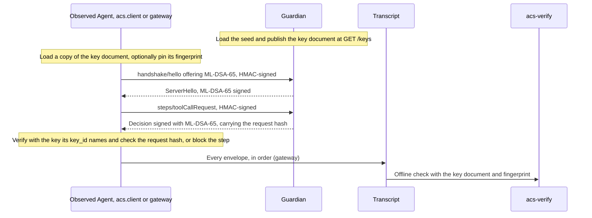

# Sign and Verify Decisions

When an auditor asks what the Guardian decided, the answer should not rest on anyone's word. A signature can settle it, but only one that a single party can produce. Release 0.1.5 adds experimental post-quantum decision signing and an offline checker, so a third party can confirm what a Guardian signed long after the session ended.

## See why HMAC is not enough

**ACS-Core** is the mandatory baseline of the specification, the part every conformant deployment implements. Every ACS-Core deployment signs its envelopes with HMAC-SHA256. Both sides derive the same per-session key from a shared secret, so the signature proves the message was not changed in transit. It cannot prove who wrote it. A valid HMAC shows that a holder of the session key produced the message, and the agent holds that key as surely as the Guardian does ([§10](../spec/instrument/specification.md#10-cryptographic-signatures)).

That is fine inside one trust domain, where the agent and the Guardian run under the same operator. It falls short when the two sit on opposite sides of a trust boundary, or when someone outside both must judge a dispute. The project leads decided that ACS uses symmetric keys inside a trust domain and asymmetric keys across trust domains ([D-047](../decisions/index.md#d-047-use-symmetric-keys-inside-a-trust-domain-and-asymmetric-keys-across-trust-domains)). Which hooks need which kind waits until after specification v0.2.0.

## Know what ships in 0.1.5

HMAC-SHA256 stays the default on every component. Nothing below changes until you turn it on.

**ML-DSA-65** is a post-quantum signature algorithm standardized in FIPS 204. With `ACS_RESPONSE_SIGNING=ML-DSA-65`, the Python example Guardian signs every response with its own ML-DSA-65 key. Requests stay on HMAC. The Guardian publishes its public key in a **key document**, served at `GET /keys`, and prints the key's fingerprint at startup so an operator can compare the two.

On the agent side, `acs.client` and the gateway verify those answers when `ACS_RESPONSE_ALGORITHMS=ML-DSA-65` names the algorithm and `ACS_GUARDIAN_KEYS` names a copy of the key document. The verifier takes the algorithm from the key, never from the envelope, so a forged envelope cannot pick a weaker check. Each key carries a `key_id`, the label a signature uses to name the key that made it. A decision that fails verification blocks the step whatever the failure posture says.

One key signs every session, so each signed answer also carries a hash of the request it answers, inside the signed bytes. An answer captured in one session therefore fails as the answer to any other request.

All of this needs the `pqc` extra. It is experimental and off by default. It is a lab convention built for the project's December 9, 2026 guided lab, and release 0.1.5 makes no ACS-Crypto conformance claim for it. ACS-Crypto is the optional conformance profile for asymmetric and post-quantum signatures. No hybrid signature ships.

The diagram starts with the **handshake**. The agent's `handshake/hello` message, its ClientHello, offers the algorithms it can verify, and the Guardian's **ServerHello** answers with the ones the session will use.

[Signing With ML-DSA-65](https://github.com/GenAI-Security-Project/agent-control-standard/blob/main/adapters/docs/signing.md) owns the library API, the variant, the context string and the binding rules. The [Decision signing section](https://github.com/GenAI-Security-Project/agent-control-standard/blob/main/adapters/docs/guardian/README.md#decision-signing-lab-convention) of the Guardian README owns the settings, the key tool and the key document format.

## Check a session offline

`acs-verify` checks a session transcript with nothing but the transcript and the Guardian's key document. The gateway writes that transcript, one file per session, as [Govern an unmodified agent](./gateway.md#keep-the-transcript) describes.

It recomputes the audit chain, verifies every decision signature, checks that each answer belongs to the request before it, and checks that the key was valid when the request was made. It names the first line that fails. It ships as a module, so you run it as `python -m acs.testing.verify` from `adapters/`.

What a pass proves depends on what you gave it. Under ML-DSA-65 with the fingerprint the Guardian printed, a pass shows that the Guardian holding that key signed each decision, as the answer to its request, while the key was valid. Without the fingerprint, a pass shows only that the transcript matches the key document beside it. Under HMAC-SHA256, a pass shows only that someone holding the shared secret wrote each answer. [Checking a Transcript With acs-verify](https://github.com/GenAI-Security-Project/agent-control-standard/blob/main/adapters/docs/acs-verify.md) lists every flag and exit code.

## Know the limits

These limits hold in release 0.1.5:

- Keep TLS on the connection to the Guardian. Signatures protect what was decided, not who can reach the port.
- The `pqc` and `nat` extras cannot be installed together, so a NAT deployment signs with HMAC-SHA256 only.
- The key document format, the request hash and the handshake fields that negotiate ML-DSA-65 are lab conventions. Specification v0.1.0 does not yet say how an asymmetric key is published, bound to an identity or revoked.
- Only the Python example Guardian signs with ML-DSA-65. The Go Guardian signs with HMAC-SHA256, and the TypeScript AGT Guardian does not sign yet.

## Weigh the cost

An ML-DSA-65 signature is about 100 times larger than an HMAC-SHA256 tag, and signing takes about 40 times longer at the median. On a laptop that is still 0.39 ms at the median, as measured on the [Signature benchmark](./signature-benchmark.md) page, which gives the numbers, the method and how to rerun it on your own hardware.

## Read Next

- [Signature benchmark](./signature-benchmark.md)
- [Specification §10: Cryptographic Signatures](../spec/instrument/specification.md#10-cryptographic-signatures)
- [D-047 in the Decision Log](../decisions/index.md#d-047-use-symmetric-keys-inside-a-trust-domain-and-asymmetric-keys-across-trust-domains)
- [Conformance Profiles](../spec/conformance.md)
