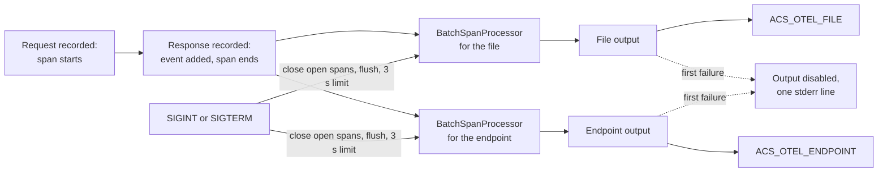

# Guardian

The ACS server. It serves one JSON-RPC 2.0 endpoint, `POST /acs`. For each envelope it validates the request against the schemas in this repository's [`specification/v0.1.0/`](../../../../specification/v0.1.0/), assembles AGT policy input, evaluates it through the [AGT bridge](../agt-bridge/README.md), and maps AGT's verdict to an ACS decision. It keeps one hash chain per session and records every envelope before it validates it.

The Guardian never names a host. It does not know whether Claude Code or OpenCode sent the envelope. That boundary is enforced by [`test/invariants.test.ts`](../../test/invariants.test.ts) at the root of the tree.

## Get started

Run it from `reference-implementations/agt`. Its default paths are relative to that directory.

```bash
export ACS_HMAC_SECRET="$(openssl rand -base64 32)"
export ACS_HMAC_KEY_ID="2026-10"
bun run guardian
```

```
Guardian listening at http://localhost:8787/acs
Envelope log: .acs/envelopes.jsonl
Session context log: .acs/session-context.jsonl
Failure posture: proceed   (override with ACS_ON_DECISION_FAILURE=deny)
Signature verification: HMAC-SHA256 (required)
```

It constructs the AGT runtime once, at startup, against `policy/manifest.yaml`, then serves until you stop it. Every variable it reads:

| Variable | Default | What it does |
|---|---|---|
| `ACS_ON_DECISION_FAILURE` | `proceed` | The posture the ServerHello declares. `deny` fails closed. Any other value stops the Guardian at startup |
| `ACS_GUARDIAN_PORT` | `8787` | The port for `POST /acs` |
| `ACS_GUARDIAN_HOST` | `127.0.0.1` | The interface to bind. Set `0.0.0.0` only after protecting the transport and provisioning the shared secret to every intended peer |
| `ACS_MANIFEST_PATH` | `policy/manifest.yaml` | The AGT manifest. `policy/manifest.drift.yaml` is the second manifest, used to reach the `warn` verdict |
| `ACS_ENVELOPE_LOG` | `.acs/envelopes.jsonl` | Where every envelope is recorded |
| `ACS_SESSION_CONTEXT_LOG` | `.acs/session-context.jsonl` | Where each session's hash chain is written |
| `ACS_OTEL_FILE` | unset | Writes one OpenTelemetry span per decided step as OTLP/JSON, one export request per line. Unset means no trace export |
| `ACS_OTEL_ENDPOINT` | unset | Sends the same spans to an OTLP/HTTP collector, for example `http://127.0.0.1:4318/v1/traces` |
| `ACS_HMAC_SECRET` | required | Base64-encoded input keying material of at least 32 bytes. The Guardian derives per-session keys, verifies requests, and signs addressable non-ping results and errors |
| `ACS_HMAC_KEY_ID` | required | The label that names `ACS_HMAC_SECRET`, carried as `key_id` in every signature (§10). No default. A request naming another label gets an unsigned `-32004 SIGNATURE_INVALID` |

To see a decision without an agent client, pipe a hook payload into the Claude Code shim while the Guardian runs. The [tree README](../../README.md#drive-one-hook-by-hand) shows the command and its output.

## What happens to each request

1. The raw envelope is appended to the envelope log, before anything else.
2. The JSON-RPC and common-envelope shape is validated. Except for the signature-exempt liveness ping, the Guardian then verifies the per-session HMAC, rejects timestamps outside the skew window, and rejects a reused `request_id` from its independent replay store. This includes ClientHello: HMAC key material is provisioned out of band, not negotiated in-band.
3. The authenticated method-specific payload is validated. Invalid `steps/*` payloads receive an honoured `deny`, not a bare error, so the host has a decision to act on without letting malformed unsigned traffic bypass authentication.
4. A `steps/toolCallResult` whose `request_id_ref` names no `toolCallRequest` in the session gets the finding `request_id_ref_unresolved` on its own hash-chain entry (step 8), because `hooks.md` requires the Guardian to record a reference it cannot resolve. A readable copy goes to the envelope log as a `finding` line, or to stderr as an `acs-finding` line when there is no envelope log or it has disabled itself. The decision is left to policy. Both shipped hookmaps name the host's per-call id as `call_id` (`tool_use_id` for Claude Code, `callID` for OpenCode). The shim derives the request's `request_id` from it and sends the same value as the result's `request_id_ref`. A host that leaves the id out gets a random `request_id` and no reference. Results are governed only for the tools the hookmaps name, and Claude Code reports a failed call through `PostToolUseFailure`, which isn't mapped, so a failed call sends no result.
5. A step whose `request_id` an earlier step in the session already carried gets a `request_id_duplicate` finding the same way, and is still decided. The replay check in step 2 already refuses a repeat inside the skew window, so this fires only for one it let through, such as a repeat from outside the window.
6. Registered tool calls are resolved through `mapping.yaml`; unknown tool names receive `tool_unregistered`. Native step hooks and wrapped `protocols/MCP/tools/call` requests use the same registry.
7. The AGT snapshot is assembled and evaluated through the bridge. Its verdict is mapped to an ACS decision; a `transform` becomes the gate-appropriate `modify` operation.
8. One entry is appended to the session's hash chain. Information-flow labels AGT emitted are stored, so the next step of the session sends them back as input.
9. Every addressable non-ping result or error is signed; ping stays signature-exempt in both directions. Every response is checked against the applicable response shape, recorded, and sent. The outbound schema result is diagnostic and never replaces the response.

`handshake/hello` validates the ClientHello, requires support for ACS `0.1.0`, intersects the client's methods with the methods this Guardian actually evaluates, and accepts the `acs-core` profile only when HMAC is configured. The evaluated set is `steps/toolCallRequest`, `steps/toolCallResult`, and `protocols/MCP/tools/call`; lifecycle hooks remain dispatchable audit events but are not advertised as policy-evaluated. The Guardian records each session's `methods_implemented` and refuses, with `-32003`, any step from a session that has not sent `handshake/hello` or for a method that session did not list. `system/ping` needs no handshake. Any other method is answered with a JSON-RPC error carrying `METHOD_NOT_DISPATCHED_CODE`.

Every throw on the request path is caught. Nothing escapes the fetch handler, because an unhandled rejection would produce an HTML error page, the host's client would fail to parse it, and Claude Code would read the failed hook as "never fired" and proceed ungoverned.

## Export traces

Set `ACS_OTEL_FILE`, `ACS_OTEL_ENDPOINT`, or both. With neither set, no exporter exists and the Guardian runs exactly as before. This is an exporter for the two live methods, not an ACS-Trace conformance claim. To go from a fresh clone to a trace file of your own, follow [Produce a trace](../../README.md#produce-a-trace) in the tree README.

```bash
ACS_OTEL_FILE=.acs/otel-traces.jsonl bun run guardian
```

Each step the Guardian trusted becomes one span, named by [`trace/otel-mapping.json`](../../../../specification/v0.1.0/trace/otel-mapping.json): `gen_ai.tool.call` for `steps/toolCallRequest` and `gen_ai.tool.result` for `steps/toolCallResult`. The span opens when the request is recorded and closes when the response is. It carries each attribute the mapping lists for it when the envelope supplies a value. An attribute the envelope omits, such as `acs.capability`, is absent from the span.

Every span also carries `acs.session.id`, and `acs.request_id` whenever the envelope has one, so a session can be rebuilt from the trace alone. When an argument or output carries a Provenance object, the span carries `acs.provenance.origin` as an array, one element per Provenance object in wire order. `acs.provenance.source_id` is the matching array, with `""` where an object has no `source_id`, and it is left out when no object has one. Both stop at 64 objects. `acs.provenance.lineage_depth` is not emitted: `provenance.json` defines no such field.

Every string attribute is cut at 4096 characters, a long `acs.reasoning` included, so one large request cannot grow the export queue without bound. The sampler and span limits are set in code, so `OTEL_TRACES_*`, `OTEL_SPAN_*`, `OTEL_ATTRIBUTE_*` and `OTEL_BSP_*` variables in the environment do not change what is exported, and the endpoint output is never compressed. `OTEL_EXPORTER_OTLP_*HEADERS` still add headers to the endpoint's requests, and a loopback endpoint is added to `NO_PROXY` so an `HTTP_PROXY` cannot route it.

The decision rides on the span as an `acs.decision` event. The event always carries `acs.decision`, carries `acs.reasoning` when the response has one, and carries `acs.reason_codes`, `acs.policy.ids`, `acs.policy.versions`, `acs.policy.rule_ids`, `acs.cited_provenance_ids` and `acs.chain_hash` only when the response carries them. `acs.evaluator` appears when the Guardian's response carries `metadata.evaluator`, which this Guardian always sets to `deterministic`.

This Guardian does not send `chain_hash`, `cited_provenance_ids`, or `policy_version` on its responses yet. `acs.chain_hash` and `acs.cited_provenance_ids` are absent from its spans, and `acs.policy.versions` carries `""` for each policy reference. The three policy arrays always have the same length as `policy_references`, with `""` where a reference has no value. A valid `handshake/hello`, a valid request for a method this Guardian does not dispatch, and an unparseable body produce no span.

A step that got no decision is recorded as an `acs.decision.failure` event on the same span, with `acs.failure.class`, `acs.failure.posture` and `acs.failure.reported_by`, plus the error code, the timeout, the elapsed time and the request size when known. The Guardian emits it for an error it answered instead of a decision, for a decision it finished after the negotiated timeout, and for a step still open when it shut down. It carries the error code but never the error text, because that text can quote the request. The converter below produces the same event, reported by the observed agent, from the host adapter's audit log.

A request the Guardian cannot vouch for is recorded apart from the steps it governed, as a `guardian.rejected_request` span. Such a request can carry any session and request id, a genuine request's included. So the span carries no `acs.session.id`, `acs.request_id`, step attribute or `acs.decision` event. It records the ids the request claimed as `guardian.rejected.claimed_session_id` and `guardian.rejected.claimed_request_id`, with `guardian.rejected.reason` and, for an error answer, `guardian.rejected.error_code`. These names belong to this Guardian, not to the ACS mapping.

The reasons are `envelope_invalid`, for an envelope that fails validation, and `signature_invalid`, `replay_detected` or `timestamp_out_of_window`, for a step answered with that error by whichever check produced it. The last is `guardian_fault`, for a request the Guardian could not check at all, a missing schema directory for example. The host got an error for that one, so its span also carries an `acs.decision.failure` with class `guardian_error`. Two refusals are not rejected requests: `-32003 CAPABILITY_NOT_NEGOTIATED` and the `-32000` replay-store capacity refusal both come after the signature is verified, so the request's ids are authentic, and its span records them as an `acs.decision.failure` with class `guardian_error`.

The file holds one OTLP `ExportTraceServiceRequest` per line, the shape the Collector's file exporter writes, with `service.name` set to `acs-reference-guardian` (the converter below uses `acs-reference-audit-converter`, and both are labels, not attribution). Spans are batched and flushed when the Guardian closes on SIGINT or SIGTERM. A SIGKILL loses the last batch, and so does an output that has not finished three seconds into shutdown: the Guardian reports it on stderr and exits instead of waiting. [`otel-collector.yaml`](../../otel-collector.yaml) at the root of this tree receives the endpoint output and writes the same file shape.

Export never touches a decision. Each output fails on its own: the first failed write or send disables that output for the rest of the process and prints one line on stderr, the other output keeps running, and the response goes out unchanged.

The diagram shows the exporter's inside. Look for the split after a span ends: each output gets its own batch processor and its own failure switch, so nothing on one side can stop the other.



Each processor sends a batch about every five seconds. At shutdown, the exporter first ends any span still open with an `acs.decision.failure` event, then flushes both processors. An output that hasn't finished within three seconds is reported on stderr and its unexported spans are dropped.

Use synthetic sessions for lab runs. The envelope log holds raw envelopes before any redaction, a span's `acs.reasoning` repeats the Guardian's explanation of them, and `acs.provenance.source_id` goes out as the host sent it: by `provenance.json` it can be a URL or a file path, so a signed URL or a home-directory path would too ([issue #71](https://github.com/GenAI-Security-Project/agent-control-standard/issues/71)).

### Convert the host audit log

The failures only the host sees, a Guardian it could not reach or one that answered too late, are in the host adapter's audit log, not in the Guardian's file. `audit-to-otlp.ts` turns that log into the same OTLP/JSON shape: one span per posture entry, with an `acs.decision.failure` event whose `acs.failure.reported_by` is `observed_agent`. Each span carries the same `acs.session.id` and `acs.request_id` as the Guardian's span for that request, so the two files join. It does not carry `gen_ai.tool.name`, because the audit log does not record the tool.

```bash
bun run packages/guardian/src/audit-to-otlp.ts .acs/audit.jsonl .acs/otel-audit.jsonl
```

Run it after the agent session has ended, into a file that does not exist when it starts. It refuses an existing output path, so it doesn't append into the audit log, the Guardian's trace file, or its own earlier run, and a wrong audit path or mapping leaves no file behind.

`acs.failure.posture` is the deployment's posture, not what became of the step. A refused request shows `fail_open` under a `proceed` deployment even though the host blocked it. The detail sentence says so, and the error code is in `acs.failure.error_code`. The detail is always a sentence the converter writes, never the host's message, which quotes the Guardian's error text.

Entries with `outcome: "ungoverned"` are skipped: those are steps no gate asked about, which the failure classes do not cover. Also skipped, and counted on stdout:

- entries whose method has no `step_to_span` entry;
- entries with no method, by failure kind, because the host never built a request for them;
- replay rejections;
- lines it cannot read.

It prints how many spans reached the file and exits non-zero when that is fewer than it built.

### Sample trace

[`samples/trace/acs-trace-sample.jsonl`](../../samples/trace/acs-trace-sample.jsonl) is what this export looks like, so you can read it without running the Guardian. It holds five steps and one rejected request: an allowed tool call and its result, linked by `acs.request_id_ref`, a denied call carrying reasoning, reason codes, policy references and provenance, a forged request that reuses the allowed call's ids and fails the schema, recorded as a `guardian.rejected_request` span so the allowed call keeps the only span under its pair, a decision that finished after the timeout, and a step the host could not deliver, converted from its audit log. The decisions come from the stock policy, and the one late decision is delayed on purpose. Every value in it is synthetic.

```bash
bun run sample:trace
```

That command regenerates it. `test/sample-trace.test.ts` checks the sample against `otel-mapping.json` and fails when the exporter's output no longer matches it, so a change to the exporter or the mapping comes with a regenerated sample. The converted span has no `gen_ai.tool.name`, because the audit log does not record the tool (issue #274). Like the exporter, the sample covers two hook methods and is not an ACS-Trace conformance claim.

### Troubleshooting

These are the messages export can print, with what each one means. None of them changes a decision.

- `otel trace export to <path or URL> disabled after failure: <reason>` on the Guardian's stderr. That output failed its first write or send and is off until the Guardian restarts. The other output keeps running. For an endpoint, the usual cause is a collector that wasn't running yet or was restarted: stop the Guardian, start the collector, then start the Guardian again.
- `otel trace exporter disabled after failure: <reason>`, with no output named. The exporter as a whole stopped, for example because `otel-mapping.json` didn't load. No spans reach either output for the rest of the process.
- `otel trace exporter shutdown disabled after failure: did not finish within 3000 ms; unexported spans were dropped`. An output stalled at shutdown. The spans still in its queue are lost.
- `otel trace export to <URL>: an HTTP proxy is set and NO_PROXY/no_proxy did not exempt <host>, so on some Bun versions these spans go through the proxy.` at startup. Your shell has `HTTP_PROXY` set, and the loopback host isn't in the proxy exemption list Bun reads. The Guardian adds the host itself, which takes effect on Bun 1.3.14 and later. On older versions, start the Guardian with the host in both `NO_PROXY` and `no_proxy`, as step 1 of [Produce a trace](../../README.md#produce-a-trace) does.
- `refusing to write <path>: it already exists, perhaps from an earlier or failed run.` from the converter, which then exits with status 1. It never appends. Delete the old output or name a new file.
- An empty `.acs/otel-collector-traces.jsonl` in the first five seconds after you send a step. That's normal: spans leave in batches about every five seconds, and stopping the Guardian with Ctrl-C sends the last one. If the file still hasn't appeared after about ten seconds, the collector isn't running [`otel-collector.yaml`](../../otel-collector.yaml), or the Guardian printed the `disabled after failure` line above.

## Use it in-process

The tests and the conformance harness start a Guardian in the same process.

```ts
import { startGuardian } from "guardian";

const guardian = await startGuardian({
  port: 0,
  manifestPath: "policy/manifest.yaml",
  hmacSecret: process.env.ACS_HMAC_SECRET,
  hmacKeyId: process.env.ACS_HMAC_KEY_ID,
});
// guardian.url is the full endpoint, on the port the OS assigned.
await guardian.close();
```

`StartGuardianOptions` also accepts `hostname`, `envelopeLogPath`, `sessionContextLog`, `otelTraceFile`, `otelTraceEndpoint`, `onDecisionFailure` and `hmacSecret`, which mirror the environment variables above, and five options for tests: `mappingPath`, `annotator`, `bridge`, `sessionContextStore` and `traceExporter`. Omitting `hmacSecret` is a non-conformant mode for in-process tests, and its handshake advertises no `acs-core` profile. Each option is documented where it is declared, in `src/server.ts`.

`otelTraceEndpoint` leaves the proxy variables alone. `src/main.ts` prints the proxy warning and adds a loopback endpoint's host to whichever of `NO_PROXY` and `no_proxy` is set, or to both when neither is. An embedder that wants the same imports `loopbackProxyWarning` and `keepLoopbackOffProxy` from `guardian` and calls each with `(endpoint, process.env)` before it starts the Guardian.

The package has two entry points. `guardian` exports the governance verbs listed in `src/index.ts`. `guardian/deployment` exports `createDeploymentBridge`, the one function that builds the deployment's bridge with the egress annotator wired in. The conformance harness imports the second so it measures the bridge the Guardian ships, not a replica.

## Files

| File | What it holds |
|---|---|
| `src/main.ts` | The `bun run guardian` entry point. Reads the environment, starts the server, prints the banner |
| `src/server.ts` | `startGuardian`, the endpoint, dispatch, the two catches, and the redaction of this machine's paths from error text |
| `src/validate-envelope.ts` | The Ajv registry over the repository's schemas, and `validateEnvelope` |
| `src/check-response.ts` | The outbound check against the response schema. Reports, never throws |
| `src/handshake.ts` | `buildServerHello` |
| `src/verify-signature.ts` | Per-session HKDF derivation plus request verification and response signing |
| `src/map-verdict.ts` | Reads `mapping.yaml`. Resolves intervention points and policy-target arguments. Maps verdicts to decisions |
| `src/assemble-snapshot.ts` | The two snapshot assemblers, one per gate |
| `src/annotate-egress.ts` | Extracts an egress destination from a shell command for AGT's egress gate |
| `src/deployment-bridge.ts` | Builds the bridge with the deployment's annotator |
| `src/deny-on-invalid-envelope.ts` | Turns a schema failure on a `steps/*` method into an honoured `deny` |
| `src/session-context-store.ts`, `src/session-context.ts`, `src/ifc-labels.ts` | The per-session hash chain, provenance, and information-flow labels |
| `src/envelope-log-sink.ts` | The envelope log writer |
| `src/otel-trace-exporter.ts` | The OpenTelemetry span exporter, assembled from the three files below |
| `src/otel-mapping.ts` | Reads `otel-mapping.json`, and says which envelope field feeds each span attribute |
| `src/otlp-file-exporter.ts` | The OTLP/JSON file writer |
| `src/loopback-proxy.ts` | Keeps a loopback trace endpoint off an HTTP proxy, applied by `src/main.ts` |
| `src/audit-to-otlp.ts` | Converts the host adapter's audit log into the same OTLP/JSON file |
| `src/acs-result.ts` | The decision result type |

## Wire security

The standalone Guardian requires HMAC-SHA256 authentication. Hosts sign requests and verify result and error responses with a per-session key derived from `ACS_HMAC_SECRET`; timestamp and replay checks bound reuse. HMAC provides integrity and peer possession of the shared secret, not confidentiality or an origin policy. The endpoint therefore binds loopback by default. Protect the transport and carefully distribute the shared secret before widening the bind.

## Tests

```bash
bun test packages/guardian
```

Thirteen files. Most start a real Guardian on port 0 and drive real envelopes through the pinned policy bundle. One test copies `src/` one directory deeper into a fixed scratch directory, so the relative schema path resolves to nothing. It proves that a missing schema directory becomes a recorded JSON-RPC error and never an HTML page. The scratch directories are gitignored and removed in a `finally`.
